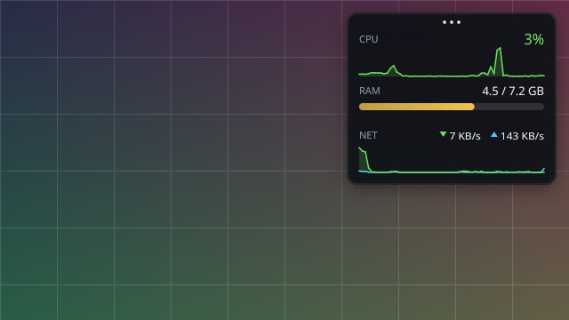
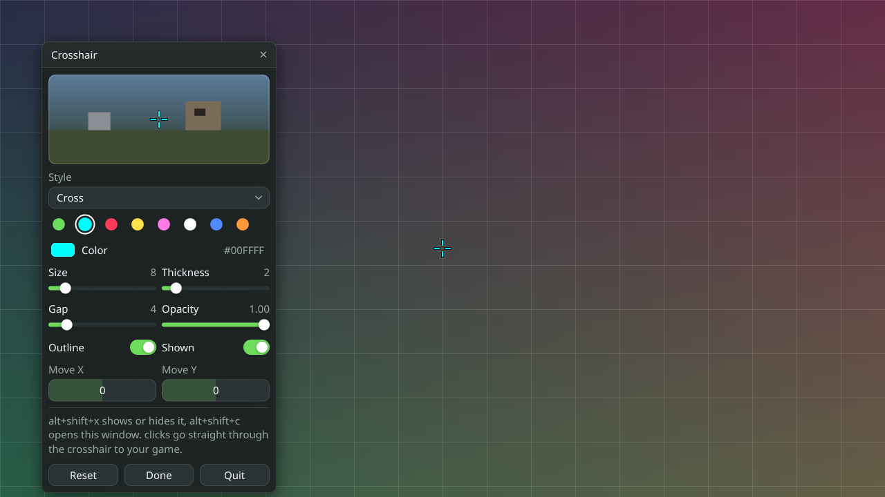
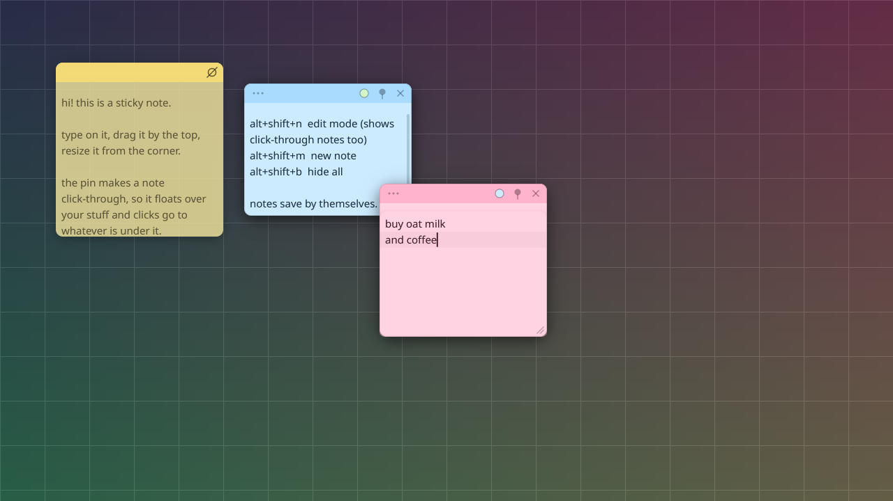
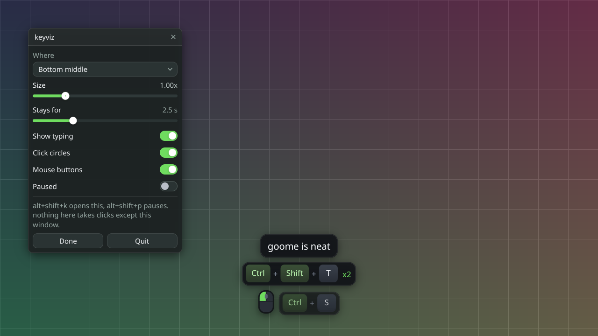

# Downloads <kbd>0.4</kbd>

Four small apps made with goome that you can just download and use. Unzip and run, theres no installer. They're also the best way to see what goome does before you write any code.

All of them are on the [latest examples release](https://github.com/goome-ui/examples/releases/latest). Each app has a zip per OS, the macOS one is a universal build for Intel and Apple chips:

| App | Linux | Windows | macOS |
|:--|:--|:--|:--|
| goome-hud | `goome-hud-linux-x86_64.zip` | `goome-hud-windows-x86_64.zip` | `goome-hud-macos-universal.zip` |
| crosshair | `goome-crosshair-linux-x86_64.zip` | `goome-crosshair-windows-x86_64.zip` | `goome-crosshair-macos-universal.zip` |
| sticky | `goome-sticky-linux-x86_64.zip` | `goome-sticky-windows-x86_64.zip` | `goome-sticky-macos-universal.zip` |
| keyviz | `goome-keyviz-linux-x86_64.zip` | `goome-keyviz-windows-x86_64.zip` | `goome-keyviz-macos-universal.zip` |

The Mac builds arent signed, so the first launch gets blocked. Right click the app and pick Open, or run `xattr -d com.apple.quarantine <app>` once.

## goome-hud



A system monitor for the corner of your screen, with temps on Linux. Drag it by the dots on top, every other part of it lets clicks through to whatever is under it. alt+shift+h hides it. [README](https://github.com/goome-ui/examples/tree/main/apps/goome-hud)

## crosshair



A crosshair in the middle of your screen for games that dont have a good one. It never takes a click and it doesnt touch the game, its just a see-through window on top. alt+shift+x toggles it, alt+shift+c opens the settings. [README](https://github.com/goome-ui/examples/tree/main/apps/crosshair)

## sticky



Sticky notes that stay over everything. Pin one to type in it, or make it click-through and use it as a cheat sheet over a game. They save to a file by themselves. alt+shift+n is edit mode. [README](https://github.com/goome-ui/examples/tree/main/apps/sticky)

## keyviz



Shows your keys and clicks on screen for tutorials and recordings. Shortcuts show up as keycaps and count up when you press them again. alt+shift+p pauses it, good right before a password. [README](https://github.com/goome-ui/examples/tree/main/apps/keyviz)

## Wayland

Wayland doesnt let apps grab global keys, so every app takes `--send` instead. Bind those in your compositor, like `goome-hud --send hide` or `goome-crosshair --send settings`. Each README has the full list.

## Build them yourself

Every app is one `main.c` plus goome. From a clone of [goome-ui/examples](https://github.com/goome-ui/examples):

```sh
cd apps/goome-hud
cc -std=c99 -O2 -I../../vendor main.c ../../vendor/goome.c -o goome-hud
```

`scripts/package-apps.sh` builds all four and makes the same zips the release has. To make your own app like these, [Templates and goome new](templates.md) gets you going in a minute.
