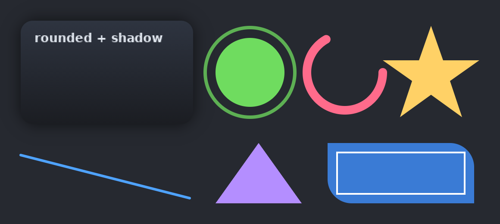

# Shapes and clipping

You dont have to use this, writing pixels into `c->px` and calling `goome_damage` works fine. Shapes are anti-aliased, no libm or any other library, so the pixels come out the same on every OS (the unit tests hash them, and CI runs them on Linux, Windows and both Macs).



Coords are logical. Colors are plain `0xAARRGGBB`, goome premultiplies them itself.

## Shapes

```c
goome_draw_rect(c, x, y, w, h, 0xFF2E3440);
goome_draw_round_rect(c, x, y, w, h, 12, 0xE0202838);
goome_draw_frame(c, x, y, w, h, 2, 0xFF6FDC5F);
goome_draw_line(c, 24, 180, 220, 230, 3, 0xFF4FA3FF);
goome_draw_triangle(c, 250, 236, 300, 166, 350, 236, 0xFFB48EFF);
goome_draw_circle(c, 290, 84, 40, 0xFF6FDC5F);
goome_draw_ring(c, 290, 84, 52, 4, 0xC06FDC5F);
goome_draw_arc(c, 400, 84, 44, 10, 0, 4.2, 0xFFFF6B8B);
```

```csharp
c.DrawRect(x, y, w, h, 0xFF2E3440);
c.DrawRoundRect(x, y, w, h, 12, 0xE0202838);
c.DrawFrame(x, y, w, h, 2, 0xFF6FDC5F);
c.DrawLine(24, 180, 220, 230, 3, 0xFF4FA3FF);
c.DrawTriangle(250, 236, 300, 166, 350, 236, 0xFFB48EFF);
c.DrawCircle(290, 84, 40, 0xFF6FDC5F);
c.DrawRing(290, 84, 52, 4, 0xC06FDC5F);
c.DrawArc(400, 84, 44, 10, 0, 4.2, 0xFFFF6B8B);
```

```python
c.rect(x, y, w, h, 0xFF2E3440)
c.round_rect(x, y, w, h, 12, 0xE0202838)
c.frame(x, y, w, h, 2, 0xFF6FDC5F)
c.line(24, 180, 220, 230, 3, 0xFF4FA3FF)
c.triangle(250, 236, 300, 166, 350, 236, 0xFFB48EFF)
c.circle(290, 84, 40, 0xFF6FDC5F)
c.ring(290, 84, 52, 4, 0xC06FDC5F)
c.arc(400, 84, 44, 10, 0, 4.2, 0xFFFF6B8B)
```

```java
c.rect(x, y, w, h, 0xFF2E3440);
c.roundRect(x, y, w, h, 12, 0xE0202838);
c.frame(x, y, w, h, 2, 0xFF6FDC5F);
c.line(24, 180, 220, 230, 3, 0xFF4FA3FF);
c.triangle(250, 236, 300, 166, 350, 236, 0xFFB48EFF);
c.circle(290, 84, 40, 0xFF6FDC5F);
c.ring(290, 84, 52, 4, 0xC06FDC5F);
c.arc(400, 84, 44, 10, 0, 4.2, 0xFFFF6B8B);
```

- `goome_draw_ring` takes `r` as the middle of the stroke.
- `goome_draw_arc` angles are radians, 0 is 3 oclock and it goes clockwise, with round caps.
- `goome_draw_poly(c, xy, n, argb)` fills a polygon from `n` x,y pairs with the nonzero rule. The star in the picture is one.

## Rounded rects, gradients and shadows

`goome_radii` gives every corner its own radius (top left, top right, bottom right, bottom left). `goome_radius(r)` makes all four the same.

```c
goome_draw_shadow(c, 24, 24, 200, 120, 14, 18, 0x90000000);
goome_draw_rrect_grad(c, 24, 24, 200, 120, goome_radius(14), 0xFF2E3440, 0xFF1B1D22, 0);
goome_draw_rrect(c, 380, 166, 170, 70, (goome_radii){0, 28, 0, 28}, 0xFF3A7BD5);
goome_draw_rrect_line(c, 380, 166, 170, 70, goome_radius(8), 2, 0xFFFFFFFF);
```

```csharp
c.DrawShadow(24, 24, 200, 120, 14, 18, 0x90000000);
c.DrawRRectGrad(24, 24, 200, 120, 14, 0xFF2E3440, 0xFF1B1D22);
c.DrawRRect(380, 166, 170, 70, new Radii(0, 28, 0, 28), 0xFF3A7BD5);
c.DrawRRectLine(380, 166, 170, 70, 8, 2, 0xFFFFFFFF);
```

```python
c.shadow(24, 24, 200, 120, 14, 18, 0x90000000)
c.rrect_grad(24, 24, 200, 120, 14, 0xFF2E3440, 0xFF1B1D22)
c.rrect(380, 166, 170, 70, (0, 28, 0, 28), 0xFF3A7BD5)
c.rrect_line(380, 166, 170, 70, 8, 2, 0xFFFFFFFF)
```

```java
c.shadow(24, 24, 200, 120, 14, 18, 0x90000000);
c.rrectGrad(24, 24, 200, 120, 14, 0xFF2E3440, 0xFF1B1D22);
c.rrect(380, 166, 170, 70, new Radii(0, 28, 0, 28), 0xFF3A7BD5);
c.rrectLine(380, 166, 170, 70, 8, 2, 0xFFFFFFFF);
```

Gradients go top to bottom, last arg 1 makes it left to right. Shadows are like css box-shadow (rect, corner radius, blur). Draw the shadow first.

## Clipping

```c
goome_clip_push(c, 20, 15, 80, 50);
goome_draw_circle(c, 60, 40, 50, 0xFF6FDC5F);
goome_clip_pop(c);
```

Nothing between push and pop draws outside the rect, text too. Snaps to whole pixels, 16 deep, and each push gets cut to the one before it. `goome_begin` resets it.

In Java `try (var clip = c.clip(20, 15, 80, 50)) { ... }` pops it for you.

## Text with the built in font

```c
double w = goome_draw_text(c, 20, 20, "hello", 1, 0xFFFFFFFF);
```

Last int is big (1) or small (0). Returns the width it drew. Java has it as a boolean at the end, `c.text(20, 20, "hello", 0xFFFFFFFF, true)`.

6 built in bitmap fonts, switch with `goome_set_font(i)`, `goome_font_count()` says how many. Real fonts are on [Images and fonts](images-fonts.md).

## Erasing and blitting

`goome_erase(c, x, y, w, h)` punches a fully see-through hole. `goome_canvas_blit(dst, src, alpha, dx, dy)` draws one canvas onto another. To cache something slow draw it once into your own canvas and blit that every frame.

## Leaving it out

`#define GOOME_NO_DRAW` before the implementation drops the drawing layer, images, fonts and the UI kit. You still get the overlay, events, hotkeys and capture.
