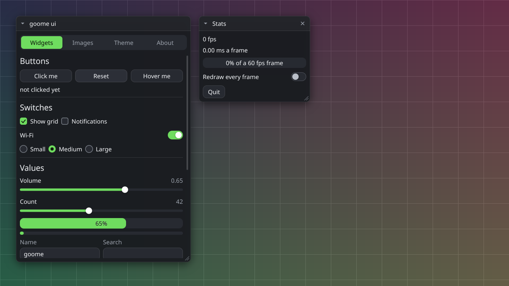

# Examples

Each repo has a few in `examples/`:

| Example | C | C# | Python | Java |
|:--|:--|:--|:--|:--|
| a box you can click and type into | `examples/hello.c` | `examples/Hello` | `examples/hello.py` | `Hello.java` |
| save a screen grab to a file | `examples/grab.c` | `examples/Grab` | `examples/grab.py` | `Grab.java` |
| the whole ui kit with every widget | `examples/ui.c` | `examples/UiDemo` | `examples/ui_demo.py` | `UiDemo.java` |

The C#, Python and Java ui demos are ports of the C one, on the test backend theyre pixel for pixel the same.

The 0.5 bindings have them too <kbd>0.5</kbd>:

| Example | Rust | Node | Go | Zig | Lua |
|:--|:--|:--|:--|:--|:--|
| a box you can click and type into | `goome/examples/hello.rs` | `examples/hello.js` | `examples/hello` | `examples/hello.zig` | `examples/hello.lua` |
| save a screen grab to a file | | | `examples/grab` | `examples/grab.zig` | `examples/grab.lua` |
| the whole ui kit with every widget | `goome/examples/ui_demo.rs` | `examples/ui_demo.js` | `examples/ui` | `examples/ui_demo.zig` | `examples/ui_demo.lua` |

Most of them also have `anim`, `text` (emoji and RTL) and an `a11y` one.

The Java ones are in `examples/src/main/java/io/github/goomeui/examples/` and each has a Gradle task, `./gradlew :examples:runUiDemo`. `Offscreen.java` fakes the input and saves a png with no window open. The Godot addon has a whole little project in `example/`, see [Godot](mods-godot.md).

## The examples repo

More examples are in [goome-ui/examples](https://github.com/goome-ui/examples), one folder each with a README and a screenshot.

