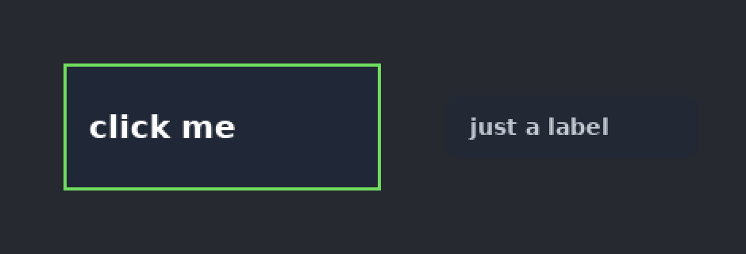

# Hit rects

In overlay mode only the rects you pass to `goome_end` take clicks. Everywhere else clicks go to the app under it.

```c
goome_rect hits[2] = {
    {40, 40, 200, 80},
    {280, 60, 160, 40},
};
goome_end(g, c, hits, 2);
```



Only the box with the green frame is a hit rect, clicks go through the label. Good for HUD text.

## Rules

- No hits = the whole overlay is click-through.
- Logical desktop coords.
- They last from the `goome_end` they were passed to until the next one, send them every frame.
- Clicks, motion and scroll only arrive over a hit (or while a press that started on one is held). For the pointer everywhere check `GOOME_CAP_GLOBAL_POINTER` and use `goome_pointer`.
- `goome_hit(g, x, y)` <kbd>0.2</kbd> says if a point is in the last `goome_end`'s hits, any mode.

## With the UI kit

`goome_ui_end` sends every window, popup and tooltip as a hit, gaps stay click-through. `goome_ui_hit(u, x, y, w, h)` adds your own for stuff you drew straight on the canvas.

## In window mode <kbd>0.2</kbd>

The whole window takes input. `goome_hit` still works.
