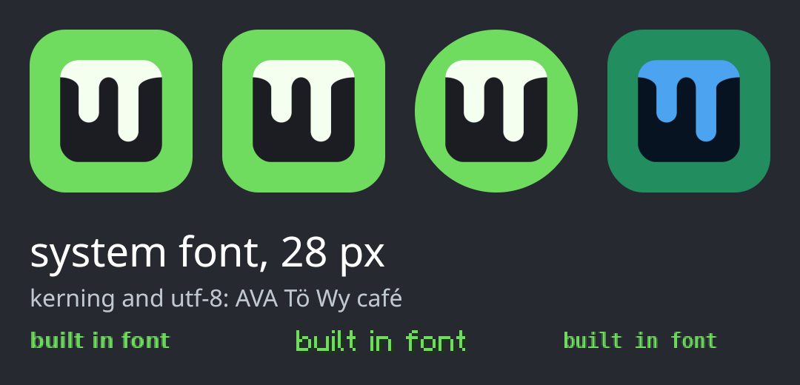

# Images and fonts



## Loading images

```c
goome_bitmap logo;
if (goome_bitmap_load("logo.png", &logo) != GOOME_OK)
    fprintf(stderr, "cant load it: %s\n", goome_bitmap_error());
goome_draw_bitmap(c, &logo, 20, 20, 110, 110, goome_radius(22), 0xFFFFFFFF);
goome_bitmap_free(&logo);
```

```csharp
using var logo = Bitmap.Load("logo.png");
c.DrawBitmap(logo, 20, 20, 110, 110, 22);
```

```python
logo = goome.Bitmap.load("logo.png")
c.bitmap(logo, 20, 20, 110, 110, radius=22)
logo.close()
```

```java
try (Bitmap logo = Bitmap.load("logo.png")) {
    c.bitmap(logo, 20, 20, 110, 110, 22, 0xFFFFFFFF);
}
```

Reads PNG (any color type and bit depth, palettes, interlaced), baseline and progressive JPEG, BMP, PPM and QOI. Goes by whats in the file, the extension doesnt matter. Reads are bounds checked, max 16384x16384.

- `goome_bitmap_load_mem(data, n, &b)` loads from memory, for images you bake into your exe.
- `goome_bitmap_from_argb(px, w, h, &b)` copies plain ARGB pixels in.
- The tint multiplies every pixel, `0xFFFFFFFF` leaves it alone. The blue logo in the picture is the same bitmap with a blue tint.
- `goome_draw_bitmap_part` draws a piece of a bitmap, for sprite sheets.
- `goome_draw_bitmap_nine` <kbd>0.2</kbd> draws a nine-slice: the corners stay their size and the edges and middle stretch. `l`, `t`, `r`, `bm` are the border sizes in bitmap px.

Bitmaps are yours to free. Load once, not every frame.

## Fonts

```c
goome_font *f = goome_font_system(NULL);
goome_text(c, f, 28, 20, 150, "system font, 28 px", 0xFFFFFFFF);
double w = goome_text_measure(f, 16, "how wide is this", NULL);
goome_font_free(f);
```

```csharp
using var f = Font.System()!;
c.DrawText(f, 28, 20, 150, "system font, 28 px", 0xFFFFFFFF);
double w = f.Measure(16, "how wide is this");
```

```python
f = goome.Font.system()
c.font_text(f, 28, 20, 150, "system font, 28 px", 0xFFFFFFFF)
w, h = f.measure("how wide is this", 16)
```

```java
try (Font f = Font.system(null)) {
    c.text(f, 28, 20, 150, "system font, 28 px", 0xFFFFFFFF);
    double w = f.width("how wide is this", 16);
}
```

- `goome_font_load(path)` takes .ttf, .otf and .ttc. `goome_font_load_index` picks a face out of a .ttc.
- `goome_font_system(NULL)` finds the desktop's normal UI font (through fontconfig on Linux if its there, Segoe UI on Windows, SF or Helvetica on Mac). Pass a name to look for that one instead.
- `goome_font_load_mem(data, n, copy)` loads from memory. With `copy` 0 the data has to stay around as long as the font does.
- `y` is the top of the text, not the baseline. `goome_text_line_height` gives you the line height for a size.
- Kerning and utf-8 work. Glyphs get cached per size.
- NULL font = the built in bitmap fonts, those work with no fonts installed at all.
- Emoji come out in color, missing letters come from fallback fonts, and Arabic and Hebrew go right to left <kbd>0.5</kbd>. Thats on [Emoji, fonts and RTL](emoji-rtl.md).

The rasterizer is integer only, so the pixels are meant to be the same everywhere. The unit tests hash the output and run on Linux, Windows and both Macs in CI.
