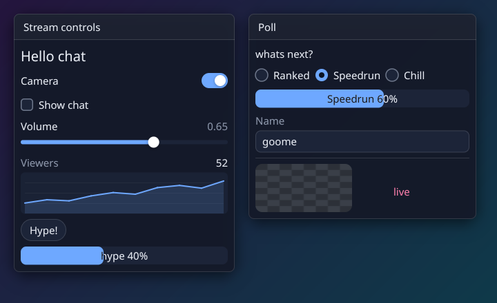
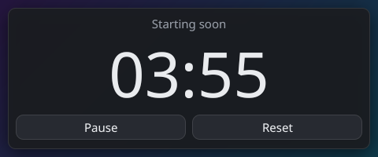

# OBS plugin <kbd>0.5</kbd>

[obs-goome](https://github.com/goome-ui/obs-goome) adds a **goome overlay** source to OBS Studio. It draws goome straight into your scene: a timer, now playing, a goal bar, a clock, a ticker or chat, or any UI you made in the [builder](ui-builder.md). Right click it and hit **Interact** and the buttons, toggles and sliders work live, even while you stream.



Every picture here is a real frame from the plugin, the tests made them.

## Install

Needs OBS Studio 31 or newer. Close OBS first. The files are on the [latest release](https://github.com/goome-ui/obs-goome/releases/latest).

### Windows

Download `obs-goome-…-windows-x64-installer.exe` <kbd>0.5.1</kbd> and run it. It installs to `C:\ProgramData\obs-studio\plugins\obs-goome`, the folder OBS looks in for plugins, and uninstalls from Settings > Apps. Its not signed, so if SmartScreen stops it click More info, then Run anyway.

Or without the installer, download `obs-goome-…-windows-x64.zip` and unzip it into `C:\ProgramData\obs-studio\plugins`, so you end up with:

```text
C:\ProgramData\obs-studio\plugins\obs-goome\bin\64bit\obs-goome.dll
```

Make the folder if its not there yet, thats where OBS looks for plugins.

### Mac

Download `obs-goome-…-macos-universal.pkg` and open it, it puts the plugin in the right spot. Its not signed yet, so if macOS blocks it right click it, pick Open, then Open again. The pkg is one universal build for Apple Silicon and Intel.

### Linux

On Ubuntu / Debian:

```sh
sudo apt install ./obs-goome-*-x86_64-linux-gnu.deb
```

Its built against the OBS from the [OBS PPA](https://launchpad.net/~obsproject/+archive/ubuntu/obs-studio), so it wants that OBS or a newer one. On other distros pull the files out of the .deb:

```sh
mkdir deb && dpkg-deb -x obs-goome-*-x86_64-linux-gnu.deb deb
mkdir -p ~/.config/obs-studio/plugins/obs-goome/bin/64bit ~/.config/obs-studio/plugins/obs-goome/data
cp deb/usr/lib/*/obs-plugins/obs-goome.so ~/.config/obs-studio/plugins/obs-goome/bin/64bit/
cp -r deb/usr/share/obs/obs-plugins/obs-goome/* ~/.config/obs-studio/plugins/obs-goome/data/
```

The Flatpak OBS cant load plugins from outside the flatpak, so it wont show up there.

After that open OBS, add a source and pick **goome overlay**.

## The built in widgets

**Show** at the top of the source settings picks what it draws. Every one of them has a theme, an accent color, a UI scale, a font and the card behind it.



| Widget | Settings |
|:--|:--|
| Timer | counts down or up, minutes / seconds, a label like "Starting soon", text for when it hits 0, Start / Pause and Reset (on stream, and in the settings so it works without Interact) |
| Now Playing | a text file your music app or Tuna / Snip writes, first line the song, second the artist. Checked every second, long names scroll |
| Goal Bar | a label, and the numbers from the settings or a file (`120`, or `120/500` to set the goal too). Slides to the new value |
| Clock | 24 hour, seconds, the date, a label. Your computers time zone |
| Ticker / Chat | a text file, newest line at the bottom. One scrolling line, or chat lines stacked from the bottom with `name: message` names in the accent color. Only reads the end of the file, so a huge log is fine |

## Your own UI from the builder

1. Make it in the [builder](https://goome.wtf/builder/) and hit **Save project (.goome.json)** in the Project menu
2. In the source settings set **Show** to **A builder file** and pick that file
3. Leave **Theme** on **From the builder file** to keep your theme, or pick a preset to swap it

Save from the builder again and the source reloads by itself, no need to touch OBS. Window spots in the builder are pixels from the top left of the source.

The plugin reads the json in C and turns it into goome ui calls, it doesnt run generated code. It does:

- Layout - windows, rows, same line, space, separators, scroll areas, tabs, collapsing, tree nodes
- Text - labels, headings and wrapped text, `{var}` in them gets filled in live
- Input - buttons, checkboxes, toggles, radios, sliders, inputs, combos, lists, color pickers
- Data - progress bars, tables, plots, images
- Menus - menu bars, menus, popups, modals
- Looks - the project theme, presets, per widget style overrides
- Logic - project vars and the click / change / on / off / hover actions (set, flip, add, take, open, close, toast, switch tab, copy)

Not yet: custom elements, split panes, the text editor, skin and icon images, hotkeys and the ui config. Those get skipped and the OBS log says how many.

The builder doesnt save pixels for images, so they draw as a checker box. Add `"file": "logo.png"` (next to the json) or a `data:` url as `"img"` on the widget in the json and it draws that.

## Interact

Right click the source, in the scene or the sources list, and pick **Interact**. OBS opens a window with the source in it, and clicks, mouse moves, scrolling and your keyboard go straight to goome. So the buttons, toggles, sliders and inputs all work and the change shows up on stream right away.

OBS doesnt let a source change the mouse cursor, so it stays an arrow over inputs.

## Themes

**Theme** has every goome preset: goome dark, goome light, Midnight, Paper, Mint, High contrast and Rose. **Use my own accent color** swaps just the accent, **UI scale** makes it bigger or smaller, **Font** takes a system font name, a path to a .ttf, or `builtin`. Turn off **Draw the card behind it** and only the text and widgets show, right on top of your scene.

## Building it

It uses the [obs-plugintemplate](https://github.com/obsproject/obs-plugintemplate) layout. On Linux you need OBS and its headers (the OBS PPA or `libobs-dev`) plus `libsimde-dev`, on Windows and Mac the scripts fetch everything:

```sh
cmake --preset ubuntu-x86_64
cmake --build --preset ubuntu-x86_64
```

`tests/run.sh check` runs the real source against a fake libobs and checks every frame against pixel hashes. On Linux, CI also loads the real plugin into libobs 32.2.0 (from the OBS PPA) under Xvfb, clicks Start on the timer and checks the frame changed. The OBS app itself is never started in CI, and the Windows and macOS builds only run against the fake libobs, so those two are built and packaged by CI (the Windows installer is silently installed and removed on the runner, the Mac pkg is never installed), not loaded by a real OBS there.
