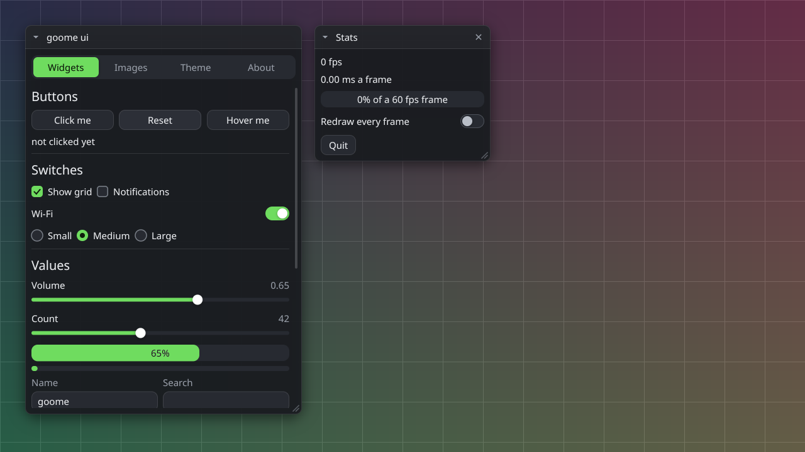

# Overlay mode

The default, and what goome always did. One see-through, always on top window over every monitor. Only the rects you pass to `goome_end` take clicks, everything else goes through to whatever is under it.

The ui demo. Only the two windows take clicks, the grid behind is the "desktop" and gets everything else.

## How it shows up on each desktop

| Where | What goome uses |
|:--|:--|
| sway, Hyprland, river, wayfire, labwc, niri, KDE Plasma 6, COSMIC | one layer-shell surface per output on the overlay layer |
| GNOME on Wayland, Cinnamon and other Wayland desktops | an X11 window on XWayland |
| any X11 desktop | one ARGB override-redirect window over the root, input shape = your hits |
| Windows 10 / 11 | one layered topmost window per monitor |
| macOS 14+ | one borderless NSPanel per screen at screensaver level |

Capture and hotkeys too: [Where it works](platforms.md).

## Things to know

Keyboard is off until `goome_keyboard(g, 1)`, otherwise you couldnt type in any other app. Turn it back off with `goome_keyboard(g, 0)` when youre done. The UI kit does it for you when a text input has focus.

Poll at least every ~30 ms while anything clickable is up. On Windows and Mac click-through gets toggled as the mouse moves and that happens inside `goome_poll`.

An empty canvas costs about nothing, the backends drop their buffers or unmap the window.

On Linux the overlay shows up in your own grabs, see [Screen capture](capture.md) to mask it out.

Also: [Hit rects](hit-rects.md), [Coords and monitors](coords.md).
