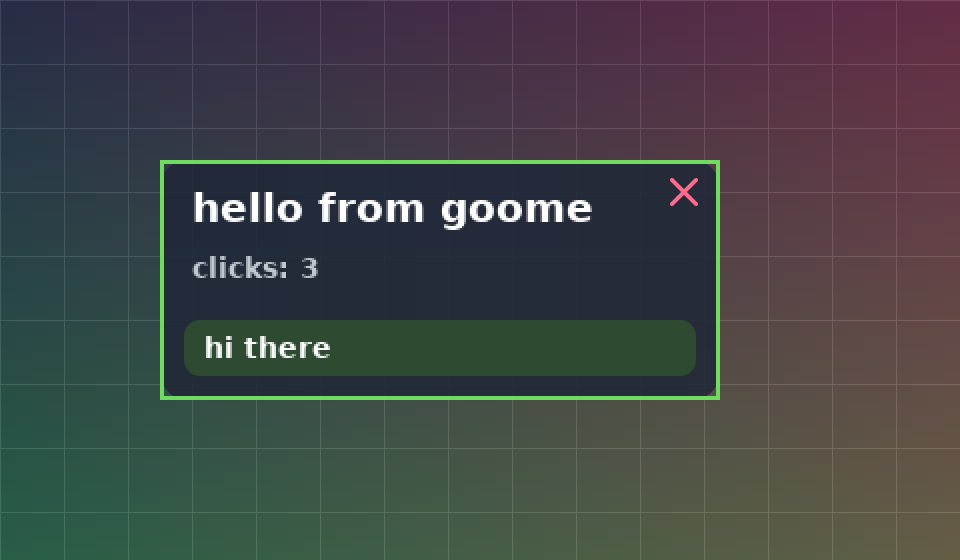

# Getting started in C

goome is one header. Drop `goome.h` in your project and compile the implementation in exactly one .c file. Nothing to link, no include paths.

To start from a project that already builds, `goome new my-app --lang c` makes one from the [C template](https://github.com/goome-ui/goome-app-template-c), see [Templates and goome new](templates.md) <kbd>0.4</kbd>.

> On Windows and only want your window, with no black console box? Add `GOOME_WINDOW_NO_CONSOLE`, see [Hide the console on Windows](windows-console.md) <kbd>0.5.5</kbd>. It is off by default.

## Pick what you are making

### Overlay on top of everything

The default. A see-through layer over every monitor, only what you mark as clickable takes clicks. [Overlay mode](overlay-mode.md)

```c
#include "goome.h"

int main(void)
{
    goome *g = goome_open(&(goome_opts){.title = "my overlay"}, NULL);
    if (!g) return 1;
    for (;;) {
        goome_event ev;
        while (goome_poll(g, &ev, 16) > 0)
            if (ev.type == GOOME_QUIT) return 0;
        goome_canvas *c = goome_begin(g, 0);
        if (!c) continue;
        goome_draw_round_rect(c, 40, 40, 240, 50, 12, 0xE0202838);
        goome_draw_text(c, 56, 56, "on top of everything", 0, 0xFFFFFFFF);
        goome_end(g, c, NULL, 0);
    }
}
```

### Make a normal app <kbd>0.2</kbd>

`goome_open_app` is `goome_open` in window mode, resizable and centered. You get a real window with a title bar and the UI kit fills it. [Window mode](window-mode.md)

```c
#include "goome.h"

int main(void)
{
    goome *g = goome_open_app("My app", 960, 640, NULL);
    if (!g) return 1;
    goome_ui *u = goome_ui_new(g);
    int running = 1, clicks = 0;
    while (running) {
        goome_event ev;
        while (goome_poll(g, &ev, 16) > 0) {
            if (ev.type == GOOME_CLOSE || ev.type == GOOME_QUIT) running = 0;
            goome_ui_feed(u, &ev);
        }
        if (!goome_ui_begin(u, 0)) continue;
        if (goome_ui_app(u, "My app", 0)) {
            if (goome_ui_button(u, "Click me")) clicks++;
            goome_ui_label(u, "clicked %d times", clicks);
        }
        goome_ui_app_end(u);
        goome_ui_end(u);
    }
    goome_ui_free(u);
    goome_close(g);
    return 0;
}
```

### Inside Unity or a game engine <kbd>0.2</kbd>

No OS window. goome draws into a buffer, your engine shows it as a texture and feeds it input. This one just renders one frame to a file. See [Offscreen mode](offscreen-mode.md) and [Getting started in Unity](start-unity.md).

```c
#include "goome.h"

int main(void)
{
    goome *g = goome_open(&(goome_opts){.mode = GOOME_MODE_OFFSCREEN, .width = 320, .height = 200}, NULL);
    if (!g) return 1;
    goome_canvas *c = goome_begin(g, 0);
    goome_draw_round_rect(c, 20, 20, 280, 160, 16, 0xFF6FDC5F);
    goome_end(g, c, NULL, 0);
    goome_image img;
    if (goome_frame(g, &img) == GOOME_OK) goome_save_ppm("frame.ppm", img.px, img.w, img.h, img.stride);
    goome_close(g);
    return 0;
}
```

## Get goome.h

Linux or Mac, in your project folder:

```sh
curl -fsSL https://raw.githubusercontent.com/goome-ui/c-goome/main/get.sh | sh
```

Windows, in PowerShell (not cmd):

```powershell
irm https://raw.githubusercontent.com/goome-ui/c-goome/main/get.ps1 | iex
```

It grabs `goome.h` and `hello.c`, makes a `goome.c` and tries to build hello. An existing `goome.h` gets moved to `goome.h.old` first, so run it again to update.

Or just download [goome.h](https://github.com/goome-ui/c-goome/blob/main/goome.h), thats the whole library.

For one exact version instead of the newest, see [Versions](versions.md).

## The implementation file

In **one** .c file (the script makes it as `goome.c`):

```c
#define GOOME_IMPLEMENTATION
#include "goome.h"
```

Everywhere else just `#include "goome.h"`. Has to be .c, not .cpp. Including the header from C++ is fine though.

## Your first overlay

A box on monitor 0 that prints every click on it. Clicks anywhere else go to the app under it.

```c
#include <stdio.h>
#include "goome.h"

int main(void)
{
    goome *g = goome_open(&(goome_opts){.title = "my overlay"}, NULL);
    if (!g) return 1;

    goome_pacer pace = {0};
    for (;;) {
        goome_event ev;
        int wait = goome_pace(&pace, 60);
        while (goome_poll(g, &ev, wait) > 0) {
            if (ev.type == GOOME_QUIT) return 0;
            if (ev.type == GOOME_DOWN) printf("clicked at %.0f,%.0f\n", ev.x, ev.y);
            wait = goome_pace(&pace, 60);
        }

        goome_canvas *c = goome_begin(g, 0);
        if (!c) continue;
        goome_draw_round_rect(c, 100, 100, 200, 80, 12, 0xE0202838);
        goome_draw_text(c, 116, 128, "click me", 1, 0xFFFFFFFF);
        goome_rect hit = {100, 100, 200, 80};
        goome_end(g, c, &hit, 1);
    }
}
```

Build:

```sh
cc -O2 -o myapp myapp.c goome.c
```

Visual Studio's compiler: `cl /O2 myapp.c goome.c`. mingw is the same `gcc` line.



Thats `examples/hello.c` from c-goome, which also has a close button, a hotkey and typing. Rendered on the [test backend](testing.md).
