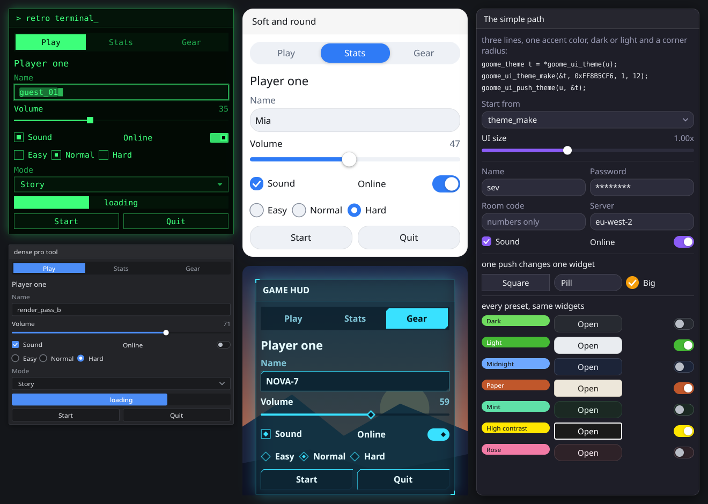

# Change anything <kbd>0.3</kbd>

Every number and color the ui kit used to have baked in is a theme field or a config field now. If you dont touch them it looks and acts exactly like before.

For a quick look start at [Themes the simple way](ui-theme-easy.md), this page is the full list.



`examples/anything.c` in c-goome. Same widgets 4 times, only the theme and the config are different.

## Theme fields

Change them on `goome_ui_theme(u)` like in [Themes](ui-theme.md), or push one for a few widgets with its `GOOME_S_*` name. Every field from `focus` on has one too:

```c
goome_ui_push_num(u, GOOME_S_CHECK_SIZE, 24);
goome_ui_push_color(u, GOOME_S_FOCUS, 0xFFFFB020);
goome_ui_checkbox(u, "Big one", &big);
goome_ui_pop(u, 2);
```

```csharp
ui.PushNum(Style.CheckSize, 24);
ui.PushColor(Style.Focus, 0xFFFFB020);
ui.Checkbox("Big one", ref big);
ui.Pop(2);
```

```python
ui.push_num("check_size", 24)
ui.push_color("focus", 0xFFFFB020)
big = ui.checkbox("Big one", big)
ui.pop(2)
```

```java
ui.pushNum(Style.CHECK_SIZE, 24);
ui.pushColor(Style.FOCUS, 0xFFFFB020);
big = ui.checkbox("Big one", big);
ui.pop(2);
```

Defaults are what `goome_ui_theme_dark` sets. `goome_ui_theme_light` only changes the first 11 colors.

### The old ones

| Field | Default | What |
|:--|:--|:--|
| `bg` | `0xFF14161A` | behind everything, app mode fills with it |
| `panel` | `0xEC1B1D22` | window background |
| `border` | `0x1CFFFFFF` | outlines |
| `text` | `0xFFE9EBEE` | normal text |
| `text_dim` | `0xFF969CA6` | quieter text |
| `accent` | `0xFF6FDC5F` | checked boxes, slider fill, the active tab |
| `accent_text` | `0xFF0F1D0C` | text on top of the accent |
| `hover` | `0xFF363A44` | widget background while hovered |
| `active` | `0xFF424752` | widget background while pressed |
| `input_bg` | `0xFF272A31` | inside inputs and sliders |
| `shadow` | `0x8C000000` | window shadow |
| `radius` | 10 | corner radius |
| `pad` | 10 | space inside windows |
| `gap` | 8 | space between widgets |
| `border_width` | 1 | outline width |
| `font_size` | 15 | text size |
| `shadow_blur` | 22 | how soft shadows are |
| `anim_ms` | 120 | animation length, 0 = no animation |
| `font` | system font | NULL = built in |
| `skin_*` | none | [Icons and skins](ui-icons.md) |
| `icon[GOOME_ICON_COUNT]` | all NULL | [Icons and skins](ui-icons.md) |
| `icon_tint` | 0 | 1 = draw icons as they are, no tint |

### Colors

0 means work it out from the other colors like it always did, so pushing the accent still moves the focus ring with it.

| Field | Default | What, and what 0 uses |
|:--|:--|:--|
| `focus` | 0 | focus ring and the input glow, 0 = `accent` |
| `select` | 0 | selected text, 0 = `accent` faded |
| `caret` | 0 | the text caret, 0 = `accent` |
| `link` | 0 | `goome_ui_link`, 0 = `accent` |
| `badge` | 0 | `goome_ui_badge` with color 0, 0 = `accent` |
| `toast` | 0 | toast background, 0 = `panel` mixed with `hover` |
| `tooltip` | 0 | tooltip background, 0 = `bg` mixed with `hover` |
| `danger` | 0 | the red close buttons, 0 = the built in red |
| `knob` | 0 | slider and toggle knobs, 0 = white |
| `dim` | 0 | behind modals, 0 = `0x73000000` |

### Sizes

The ones marked em are at font size 15 and grow with the font like before. Heights at 0 come from the font.

| Field | Default | What |
|:--|:--|:--|
| `check_size` | 18 em | checkbox and radio box |
| `check_radius` | 5 | checkbox corners |
| `toggle_w`, `toggle_h` | 38, 22 em | toggle track |
| `slider_h` | 22 em | slider height |
| `slider_track` | 6 | slider track thickness |
| `knob_size` | 8 em | slider knob radius |
| `scroll_w` | 4 | scrollbar width |
| `scroll_min` | 28 | shortest a scrollbar thumb gets |
| `item_h` | 0 | every widget row, 0 = line height + pad |
| `menu_item_h` | 0 | menu rows |
| `tab_h` | 0 | tabs |
| `win_title_h` | 0 | window title bar |
| `app_title_h` | 0 | app mode title bar |
| `menubar_h` | 0 | app menubar |
| `statusbar_h` | 0 | app statusbar |
| `focus_w` | 2 | focus ring width |
| `focus_gap` | 3 | space between the widget and its focus ring |
| `sep_w` | 1 | separator thickness |
| `grip` | 18 | window resize grip |
| `indent` | 16 em | tree indent |
| `plot_w` | 2 em | plot line width |
| `spinner` | 0 | `goome_ui_spinner` size when you pass 0, 0 = line height |
| `caret_w` | 0 | caret width, 0 = thin. Go wide for a block caret |
| `win_min_w`, `win_min_h` | 140, 50 | smallest a window resizes to |
| `pop_gap` | 6 | space between a combo or popup and what opened it |
| `menu_gap` | 3 | offset of submenus |
| `tip_pad_x`, `tip_pad_y` | 10, 7 | padding in tooltips |
| `tip_x`, `tip_y` | 14, 20 | tooltip spot from the mouse |
| `tip_radius` | 8 | tooltip corners |
| `shadow_x`, `shadow_y` | 0, 5 | shadow offset |

`check_size`, `toggle_w`, `toggle_h`, `slider_h`, `slider_track`, `knob_size`, `scroll_w`, `scroll_min` and `grip` cant be 0, at 0 or less they go back to the default. So a theme you memset and only filled half of still draws.

### Text

| Field | Default | What |
|:--|:--|:--|
| `align` | `GOOME_ALIGN_AUTO` | button and label text, `GOOME_ALIGN_LEFT`, `_CENTER` or `_RIGHT`. Auto is what each widget normally does |
| `heading_size` | 0 | `goome_ui_heading`, 0 = 1.3x the font size |
| `small_size` | 0 | badges and the statusbar, 0 = a bit under the font size |
| `font_heading` | NULL | headings, NULL = `font` |
| `font_mono` | NULL | the text editor with `GOOME_EDIT_MONO`, NULL = built in mono |
| `font_small` | NULL | badges and the statusbar, NULL = `font` |

### Motion

| Field | Default | What |
|:--|:--|:--|
| `ease` | `GOOME_EASE_SMOOTH` | `_LINEAR`, `_OUT`, `_IN_OUT`, `_BACK` or `_CUSTOM` for the `ease` function in the config |
| `hover_ms` | -1 | hover fades |
| `press_ms` | -1 | press fades |
| `popup_ms` | -1 | popups and menus opening |
| `collapse_ms` | -1 | anything that folds open or shut |
| `toast_fade_ms` | -1 | toasts fading out |

Below 0 they follow `anim_ms`.

`goome_ui_scale(u, s)` multiplies every size above that isnt em, plus the old sizes. See [Themes the simple way](ui-theme-easy.md#bigger-or-smaller).

## The config

Stuff that isnt a look goes in `goome_ui_cfg(u)`. There's one per ui and it can't be pushed, a tooltip delay changing halfway through a frame doesnt mean anything.

```c
goome_ui_config *cfg = goome_ui_cfg(u);
cfg->tip_delay_ms = 200;
cfg->blink_ms = 0;
cfg->cursor[GOOME_CUR_BUTTON] = GOOME_CURSOR_HAND;
```

```csharp
ui.Config.TipDelayMs = 200;
ui.Config.BlinkMs = 0;
ui.Config[CursorKind.Button] = CursorShape.Hand;
```

```python
ui.config.tip_delay_ms = 200
ui.config.blink_ms = 0
ui.config.cursor[goome.CUR_BUTTON] = goome.CURSOR_HAND
```

```java
Config cfg = ui.config();
cfg.tipDelayMs(200);
cfg.blinkMs(0);
cfg.cursor(Config.CUR_BUTTON, Goome.CURSOR_HAND);
```

| Field | Default | What |
|:--|:--|:--|
| `tip_delay_ms` | 500 | hover time before a tooltip shows |
| `dbl_click_ms` | 450 | max time between the clicks of a double click |
| `dbl_click_px` | 5 | how far the mouse can move between them |
| `drag_px` | 4 | how far before a press turns into a drag |
| `repeat_delay_ms` | 380 | held key or `GOOME_ITEM_REPEAT` before it starts repeating |
| `repeat_ms` | 55 | then once every this |
| `blink_ms` | 530 | caret blink, 0 = no blink |
| `menu_delay_ms` | 120 | hover time before a submenu opens |
| `toast_ms` | 3000 | how long `goome_ui_toast` with 0 ms stays |
| `scroll_lines` | 3 | lines per wheel step |
| `raise_on_click` | 1 | clicking a window brings it to the front |
| `esc_closes` | 1 | esc closes the top popup or modal |
| `tab_nav` | 1 | tab and shift+tab move focus |
| `focus_on_mouse` | 0 | 1 = clicking a widget focuses it and shows the focus ring |
| `cursor[GOOME_CUR_COUNT]` | below | the cursor each kind of widget asks for |
| `keys[GOOME_ACT_COUNT][4]` | below | the key map, set it with `goome_ui_bind` |
| `ease`, `ease_user` | NULL | `double ease(double t, void *user)` for `GOOME_EASE_CUSTOM`, t goes 0 to 1 |
| `mask` | NULL | what a password input draws per letter, NULL = `"*"` |

`goome_ui_config_default(c)` fills one with the defaults, for a reset button or to start your own. C# and Python have `ui.Config.Reset()` and `ui.config.reset()` for the ui's own one, Java has `ui.config().reset()`.

### Cursors

| Slot | Default |
|:--|:--|
| `GOOME_CUR_BUTTON` | `GOOME_CURSOR_ARROW` |
| `GOOME_CUR_INPUT` | `GOOME_CURSOR_IBEAM` |
| `GOOME_CUR_LINK` | `GOOME_CURSOR_HAND` |
| `GOOME_CUR_DRAG_VALUE` | `GOOME_CURSOR_RESIZE_EW` |
| `GOOME_CUR_SPLIT_X` | `GOOME_CURSOR_RESIZE_EW` |
| `GOOME_CUR_SPLIT_Y` | `GOOME_CURSOR_RESIZE_NS` |
| `GOOME_CUR_GRIP` | `GOOME_CURSOR_RESIZE_NWSE` |
| `GOOME_CUR_COLUMN` | `GOOME_CURSOR_RESIZE_EW` |
| `GOOME_CUR_DRAG_DROP` | `GOOME_CURSOR_MOVE` |
| `GOOME_CUR_CUSTOM_X` | `GOOME_CURSOR_RESIZE_EW` |
| `GOOME_CUR_CUSTOM_Y` | `GOOME_CURSOR_RESIZE_NS` |
| `GOOME_CUR_CUSTOM_XY` | `GOOME_CURSOR_MOVE` |

The custom ones are [custom widgets](ui-custom.md) with `GOOME_ITEM_DRAG_X`, `_DRAG_Y` or both. Set `GOOME_CUR_BUTTON` to `GOOME_CURSOR_HAND` for web style buttons.

### The key map

```c
goome_ui_bind(u, GOOME_ACT_WORD_LEFT, "alt+left");
goome_ui_bind(u, GOOME_ACT_SELECT_ALL, "ctrl+a super+a ctrl+l");
goome_ui_bind(u, GOOME_ACT_PASTE, NULL);
```

```csharp
ui.Config.Bind(KeyAction.WordLeft, "alt+left");
ui.Config.Bind(KeyAction.SelectAll, "ctrl+a super+a ctrl+l");
ui.Config.Bind(KeyAction.Paste, null);
```

```python
ui.config.bind(goome.ACT_WORD_LEFT, "alt+left")
ui.config.bind(goome.ACT_SELECT_ALL, "ctrl+a super+a ctrl+l")
ui.config.bind(goome.ACT_PASTE, None)
```

```java
ui.config().bind(Config.ACT_WORD_LEFT, "alt+left");
ui.config().bind(Config.ACT_SELECT_ALL, "ctrl+a super+a ctrl+l");
ui.config().bind(Config.ACT_PASTE, null);
```

`goome_ui_bind(u, act, combos)` replaces every key on that action. Up to 4 combos split by spaces or commas, written like [hotkeys](hotkeys.md). NULL or "" takes them all off. It returns `GOOME_EARG` if none of them parsed, Python raises then and Java gives back false.

| Action | Default |
|:--|:--|
| `GOOME_ACT_COPY` | ctrl+c super+c |
| `GOOME_ACT_CUT` | ctrl+x super+x |
| `GOOME_ACT_PASTE` | ctrl+v super+v |
| `GOOME_ACT_UNDO` | ctrl+z super+z |
| `GOOME_ACT_REDO` | ctrl+y ctrl+shift+z super+y super+shift+z |
| `GOOME_ACT_SELECT_ALL` | ctrl+a super+a |
| `GOOME_ACT_WORD_LEFT` | ctrl+left super+left |
| `GOOME_ACT_WORD_RIGHT` | ctrl+right super+right |
| `GOOME_ACT_DEL_WORD_LEFT` | ctrl+backspace super+backspace |
| `GOOME_ACT_DEL_WORD_RIGHT` | ctrl+delete super+delete |
| `GOOME_ACT_DOC_START` | ctrl+home super+home |
| `GOOME_ACT_DOC_END` | ctrl+end super+end |

They count in inputs and the text editor. A binding matches when all its mods are held and the only extra one is shift, since shift turns a move into a select. When two match the one with more mods wins, so ctrl+shift+z is redo and not undo. Plain keys like the arrows or backspace arent in the map and still do their normal thing. The full key list is on [Keyboard and focus](ui-keyboard.md).

Full list of calls on [API: more ui widgets](api-ui-more.md) and the structs on [API: types and constants](api-types.md).
