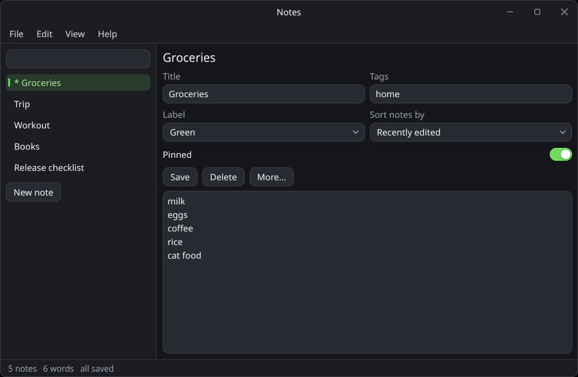
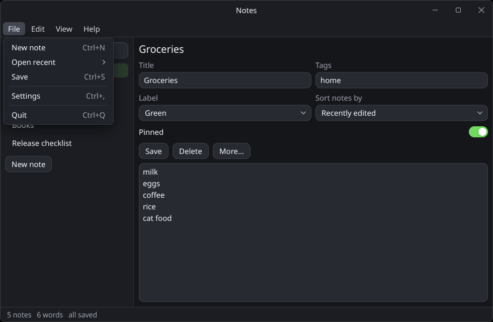

# App mode and menus <kbd>0.2</kbd>



`goome_ui_app` makes the UI fill the whole window, for [window mode](window-mode.md) apps.

```c
goome *g = goome_open_app("Notes", 960, 640, NULL);
goome_ui *u = goome_ui_new(g);
char note[4096] = "";
int dark = 1, about = 0, running = 1;

while (running) {
    goome_event ev;
    while (goome_poll(g, &ev, 16) > 0) {
        if (ev.type == GOOME_CLOSE || ev.type == GOOME_QUIT) running = 0;
        goome_ui_feed(u, &ev);
    }
    if (!goome_ui_begin(u, 0)) continue;
    if (goome_ui_app(u, "Notes", GOOME_APP_MENUBAR | GOOME_APP_STATUSBAR)) {
        if (goome_ui_menubar_begin(u)) {
            if (goome_ui_menu_begin(u, "File")) {
                if (goome_ui_menu_item(u, "Save", "Ctrl+S", NULL)) goome_ui_toast(u, "saved", 2000);
                goome_ui_menu_separator(u);
                if (goome_ui_menu_item(u, "Quit", "Ctrl+Q", NULL)) running = 0;
                goome_ui_menu_end(u);
            }
            if (goome_ui_menu_begin(u, "View")) {
                goome_ui_menu_item(u, "Dark theme", NULL, &dark);
                goome_ui_menu_end(u);
            }
            if (goome_ui_menu_begin(u, "Help")) {
                if (goome_ui_menu_item(u, "About", NULL, NULL)) about = 1;
                goome_ui_menu_end(u);
            }
            goome_ui_menubar_end(u);
        }
        goome_ui_text_edit(u, "note", note, sizeof(note), 0, GOOME_EDIT_WRAP);
        goome_ui_statusbar(u, "ready");
    }
    goome_ui_app_end(u);
    if (goome_ui_modal_begin(u, "About", &about)) {
        goome_ui_label(u, "notes, made with goome %s", GOOME_VERSION);
        if (goome_ui_button(u, "Close")) about = 0;
        goome_ui_modal_end(u);
    }
    goome_ui_end(u);
}
```

## The app panel

`goome_ui_app(u, title, flags)` is a root panel that fills monitor 0 (the window, in window mode). Call it right after `goome_ui_begin`, and `goome_ui_app_end` after its content. It returns 1.

| Flag | What |
|:--|:--|
| `GOOME_APP_TITLEBAR` | draws its own title bar: drag it to move the window, double click to maximize, and min / max / close buttons. Close pushes a `GOOME_CLOSE`. On a borderless window it also adds edge resize handles with the right cursors |
| `GOOME_APP_MENUBAR` | room for a menu bar at the top |
| `GOOME_APP_STATUSBAR` | a status bar at the bottom, set its text with `goome_ui_statusbar` |
| `GOOME_APP_NO_PAD` | no padding around the content |

`GOOME_WINDOW_BORDERLESS` plus `GOOME_APP_TITLEBAR` looks the same on every OS. Moving and resizing still go through the OS, the title bar uses `goome_window_drag`.

## Menus

`goome_ui_menubar_begin` returns 1 when it can draw menus. Each `goome_ui_menu_begin` returns 1 while that menu is open, and they nest for submenus. Always close what returned 1 with the matching end.



`goome_ui_menu_item(u, label, shortcut, checked)` returns 1 when clicked. The shortcut is just text, handle the key yourself. Pass an int for `checked` and the item toggles it and shows a check.

## Right click menus

```c
goome_ui_selectable(u, "todo.txt", 0);
if (goome_ui_context_begin(u, "file")) {
    if (goome_ui_menu_item(u, "Rename", NULL, NULL)) start_rename();
    if (goome_ui_menu_item(u, "Delete", "Del", NULL)) delete_file();
    goome_ui_context_end(u);
}
```

`goome_ui_context_begin` opens on a right click on the widget right before it, or on empty window space if there isnt one. Close it with `goome_ui_context_end` when it returned 1.

## Popups and modals

- `goome_ui_popup_open(u, id)` opens a popup, then `goome_ui_popup_begin(u, id)` / `goome_ui_popup_end(u)` draw it while its open.
- `goome_ui_modal_begin(u, title, &open)` is a centered dialog that dims everything behind it. Esc closes it by setting `open` to 0.
- `goome_ui_popup_close(u)` closes the innermost open popup, menu or modal, from inside it.

## Toasts and the status bar

`goome_ui_toast(u, text, ms)` shows a note bottom right for `ms` ms, then fades. They stack. `goome_ui_statusbar(u, text)` sets the status bar text, call it every frame you want it shown.

## Cursors

The UI sets the cursor itself (text beam over inputs, resize arrows on edges and splitters, hand on links). In offscreen mode read it with `goome_cursor_shape`.
