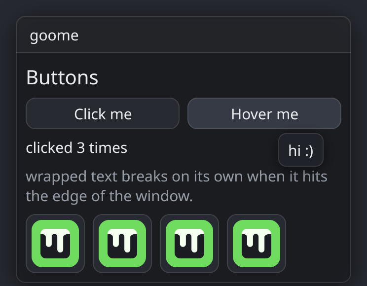

# Text and buttons

```c
goome_ui_heading(u, "Buttons");
goome_ui_row(u, 2);
if (goome_ui_button(u, "Click me")) clicks++;
goome_ui_button(u, "Hover me");
goome_ui_tooltip(u, "hi :)");
goome_ui_label(u, "clicked %d times", clicks);
goome_ui_wrapped(u, "wrapped text breaks on its own when it hits the edge of the window.");
if (goome_ui_image_button(u, "logo", &logo, 48, 48)) puts("logo");
```

```csharp
ui.Heading("Buttons");
ui.Row(2);
if (ui.Button("Click me")) clicks++;
ui.Button("Hover me");
ui.Tooltip("hi :)");
ui.Label($"clicked {clicks} times");
ui.Wrapped("wrapped text breaks on its own when it hits the edge of the window.");
if (ui.ImageButton("logo", logo, 48, 48)) Console.WriteLine("logo");
```

```python
ui.heading("Buttons")
ui.row(2)
if ui.button("Click me"):
    clicks += 1
ui.button("Hover me")
ui.tooltip("hi :)")
ui.label("clicked %d times" % clicks)
ui.wrapped("wrapped text breaks on its own when it hits the edge of the window.")
if ui.image_button("logo", logo, 48, 48):
    print("logo")
```

```java
ui.heading("Buttons");
ui.row(2);
if (ui.button("Click me")) clicks++;
ui.button("Hover me");
ui.tooltip("hi :)");
ui.label("clicked %d times", clicks);
ui.wrapped("wrapped text breaks on its own when it hits the edge of the window.");
if (ui.imageButton("logo", logo, 48, 48)) System.out.println("logo");
```

`goome_ui_label` is printf style in C. `goome_ui_wrapped` is dimmer and wraps at the window width, `goome_ui_heading` is the big one.

Image buttons need an `id` so a row of the same picture works. `goome_ui_image(u, bitmap, w, h, radius)` is just the picture, `w` 0 keeps the aspect from `h`.

A tooltip shows while you hover the widget right before it. `goome_ui_hovered(u)` checks the same thing.

Press and release both have to be on the button, slide off and it doesnt fire.


