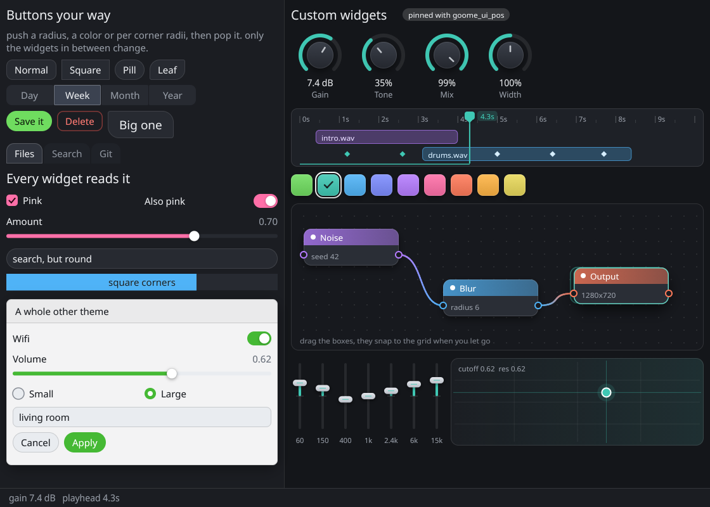

# Custom everything <kbd>0.3</kbd>

Every look setting can change for just a few widgets, widgets can go at an exact spot, and your own widgets get handled the same way the built in ones are.



`examples/custom.c` in c-goome. The right side is all custom widgets, the left is normal widgets with styles pushed.

## Push, draw, pop

```c
goome_ui_push_num(u, GOOME_S_RADIUS, 999);
goome_ui_push_color(u, GOOME_S_INPUT_BG, 0xFF6FDC5F);
goome_ui_push_color(u, GOOME_S_TEXT, 0xFF0F1D0C);
goome_ui_button(u, "Save");
goome_ui_pop(u, 3);
```

```csharp
using (ui.Style(radius: 999, inputBg: 0xFF6FDC5F, text: 0xFF0F1D0C))
    ui.Button("Save");
```

```python
with ui.style(radius=999, input_bg=0xFF6FDC5F, text=0xFF0F1D0C):
    ui.button("Save")
```

```java
try (var s = ui.style().radius(999).inputBg(0xFF6FDC5F).text(0xFF0F1D0C).push()) {
    ui.button("Save");
}
```

Only the widgets between the push and the pop change. Every built in widget reads from it, so radius 0 gives square buttons and 999 gives pills.

| Call | Pushes |
|:--|:--|
| `goome_ui_push_color(u, what, argb)` | one color, `GOOME_S_BG` to `GOOME_S_SHADOW` and `GOOME_S_FOCUS` to `GOOME_S_DIM` |
| `goome_ui_push_num(u, what, v)` | one number, `GOOME_S_RADIUS` to `GOOME_S_ANIM_MS` and the [new ones](ui-anything.md) |
| `goome_ui_push_radii(u, r)` | per corner radius, beats `GOOME_S_RADIUS` until it's popped |
| `goome_ui_push_font(u, f)` | a font, NULL = built in |
| `goome_ui_push_skin(u, kind, s)` | a [skin](ui-icons.md#skins), any `GOOME_SKIN_*`, NULL = none |
| `goome_ui_push_icon(u, icon, b)` | one [icon](ui-icons.md), any `GOOME_ICON_*`, NULL = built in |
| `goome_ui_push_theme(u, t)` | a whole theme, counts as one push |
| `goome_ui_pop(u, n)` | undoes the last n pushes of any kind |

The `GOOME_S_*` names are the [theme](ui-theme.md) fields in the same order. A pushed font size or pad changes widget heights too. Forget a pop and `goome_ui_end` pops it for you and says so once in `goome_error`.

C# has `ui.PushColor(Style.Accent, ...)`, `ui.PushNum`, `ui.PushRadii`, `ui.PushFont`, `ui.PushSkin`, `ui.PushTheme` and `ui.Pop(n)` too. Python has `ui.push_color("accent", ...)` and the rest, plus `ui.pop(n)`. Java has `ui.pushColor(Style.ACCENT, ...)`, `ui.pushNum` and the rest with `ui.pop(n)`, and `ui.style()` pushes a few in a try and pops them when it ends.

### Corners and whole themes

```c
goome_ui_push_radii(u, (goome_radii){12, 12, 0, 0});
goome_ui_button(u, "Files");
goome_ui_pop(u, 1);
```

`goome_radii` is `{tl, tr, br, bl}`. Thats tabs, `{16, 3, 16, 3}` is a leaf.

```c
goome_theme t = *goome_ui_theme(u);
goome_ui_theme_light(&t);
t.radius = 8;
goome_ui_push_theme(u, &t);
if (goome_ui_window(u, "Light one", &x, &y, &w, &h, 0, NULL)) goome_ui_toggle(u, "Wifi", &wifi);
goome_ui_window_end(u);
goome_ui_pop(u, 1);
```

`goome_ui_theme_light` leaves the font alone, so the copy keeps yours.

## Exact spots

```c
goome_ui_pos(u, 176, 3);
goome_ui_badge(u, "pinned here", 0x26FFFFFF);
goome_ui_size(u, 74, 0);
goome_ui_button(u, "Week");
```

`goome_ui_pos(u, x, y)` puts the next widget at x,y from the top left of the window, pane or app content, scroll included. The layout carries on like it wasnt there. `goome_ui_size(u, w, h)` sets the next widgets size, 0 keeps its own for that side. `goome_ui_width` still does what it did.

C# is `ui.Pos(x, y)` and `ui.Size(w, h)`, Python `ui.pos(x, y)` and `ui.size(w, h)`, Java the same as Python.

## Your own widgets

```c
double *gain = goome_ui_store(u, "gain", 1);
goome_ui_item it;
goome_ui_custom(u, "gain", 80, 80, GOOME_ITEM_DRAG_Y | GOOME_ITEM_FOCUSABLE, &it);
if (gain && it.held) gain[0] -= it.dy / 200;
if (gain && gain[0] < 0) gain[0] = 0;
if (gain && gain[0] > 1) gain[0] = 1;
goome_canvas *c = goome_ui_canvas(u);
if (c && gain) goome_draw_arc(c, it.x + 40, it.y + 40, 30, 6, 2.36, 2.36 + 4.71 * gain[0], goome_ui_theme(u)->accent);
```

```csharp
var gain = ui.Store("gain", 1);
ui.Custom("gain", 80, 80, ItemFlags.DragY | ItemFlags.Focusable, out var it);
if (it.Held) gain[0] = Math.Max(0, Math.Min(1, gain[0] - it.Dy / 200));
ui.Canvas()?.DrawArc(it.X + 40, it.Y + 40, 30, 6, 2.36, 2.36 + 4.71 * gain[0], ui.Theme.Accent);
```

```python
gain = ui.store("gain", 1)
it = ui.custom("gain", 80, 80, goome.ITEM_DRAG_Y | goome.ITEM_FOCUSABLE)
if it.held:
    gain[0] = min(1, max(0, gain[0] - it.dy / 200))
c = ui.canvas
if c:
    c.arc(it.x + 40, it.y + 40, 30, 6, 2.36, 2.36 + 4.71 * gain[0], ui.theme.accent)
```

```java
DoubleBuffer gain = ui.store("gain", 1);
Item it = ui.custom("gain", 80, 80, ItemFlag.DRAG_Y, ItemFlag.FOCUSABLE);
if (it.held()) gain.put(0, Math.max(0, Math.min(1, gain.get(0) - it.dy() / 200)));
Canvas c = ui.canvas();
if (c != null) c.arc(it.x() + 40, it.y() + 40, 30, 6, 2.36, 2.36 + 4.71 * gain.get(0), ui.theme().accent());
```

Thats a knob. `goome_ui_custom` takes a spot like any widget (and listens to `goome_ui_pos` / `goome_ui_size`), adds the hit rect and handles the mouse and tab focus like a built in widget. It returns 1 when anything happened this frame. w 0 is the normal widget width, h 0 is one line.

| Flag | What |
|:--|:--|
| `GOOME_ITEM_DRAG_X` | draggable, on its own it only moves sideways |
| `GOOME_ITEM_DRAG_Y` | draggable, on its own only up and down. Both flags = free drag |
| `GOOME_ITEM_FOCUSABLE` | gets tab focus and the keys in `it.key` |
| `GOOME_ITEM_NO_HIT` | never hovered or pressed, for a background you put other widgets on |
| `GOOME_ITEM_REPEAT` | `clicked` fires on the press and then keeps firing while held |

With a drag flag it grabs like a slider does ([Taking input from the game](input-capture.md)). Without one its a button and never grabs. A focused one gets the keys raw with `GOOME_SHIFT` and friends ored in. Only tab and shift+tab still move focus and esc drops it. Enter or space counts as a click. When two overlap the one you call first gets the press, so backgrounds want `GOOME_ITEM_NO_HIT`.

### What you get back

| Field | |
|:--|:--|
| `x, y, w, h` | where it ended up, logical |
| `hovered`, `pressed`, `held`, `released`, `clicked` | this frame. `pressed` is the down, `held` every frame after, `clicked` a release on it |
| `double_clicked`, `right_clicked`, `focused` | |
| `mx, my` | the pointer |
| `dx, dy` | moved this frame while held, after the axis lock |
| `drag_x, drag_y` | moved since the press, after the axis lock |
| `key` | the key pressed this frame while focused, 0 = none |

`it.x` and `it.y` are canvas coords and `goome_ui_pos` counts from the content top left. `examples/custom.c` puts a 1x1 `GOOME_ITEM_NO_HIT` item at `goome_ui_pos(u, 0, 0)` first and uses its x,y as the origin to turn one into the other.

### Drawing it and keeping state

`goome_ui_canvas(u)` gives a canvas for the normal `goome_draw_*` calls. What you draw lands between the widgets in the right order and gets clipped like them. It can be NULL, check it.

`goome_ui_store(u, id, n)` keeps n doubles per id between frames, all 0 the first time. Use a slot as a "set up already" flag if 0 isnt a good start value, `examples/custom.c` does that for every knob. NULL means it ran out of memory. In C# its a `Span<double>`, in Python a memoryview of doubles, in Java a `DoubleBuffer`.

Full list on [API: styles and custom widgets](api-ui-custom.md).
