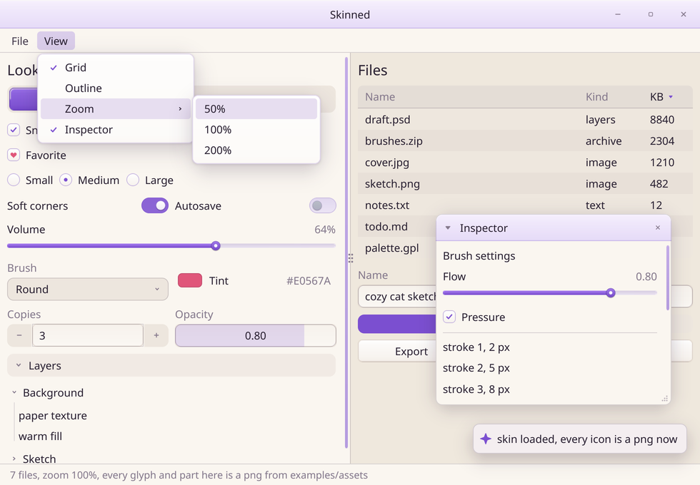

# Icons and skins <kbd>0.3</kbd>

Everything the ui kit draws by itself can be a picture instead. Small glyphs are icons, bigger parts are nine-slice skins.



`examples/skinned.c` in c-goome. Every icon and part in there is a small png from `examples/assets`, `tests/mkicons.py` is what made them.

## Icons

```c
goome_bitmap check, heart;
goome_bitmap_load("check.png", &check);
goome_bitmap_load("heart.png", &heart);
goome_ui_theme(u)->icon[GOOME_ICON_CHECK] = &check;

goome_ui_push_icon(u, GOOME_ICON_CHECK, &heart);
goome_ui_checkbox(u, "Favorite", &fav);
goome_ui_pop(u, 1);
```

```csharp
var check = Bitmap.Load("check.png");
var heart = Bitmap.Load("heart.png");
ui.Theme.Icons[Icon.Check] = check;

using (ui.Style(icon: (Icon.Check, heart)))
    ui.Checkbox("Favorite", ref fav);
```

```python
check = goome.Bitmap.load("check.png")
heart = goome.Bitmap.load("heart.png")
ui.theme.icon[goome.ICON_CHECK] = check

with ui.style(icons={goome.ICON_CHECK: heart}):
    fav = ui.checkbox("Favorite", fav)
```

```java
Bitmap check = Bitmap.load("check.png");
Bitmap heart = Bitmap.load("heart.png");
ui.theme().icon(Icon.CHECK, check);

try (var s = ui.style().icon(Icon.CHECK, heart).push()) {
    fav = ui.checkbox("Favorite", fav);
}
```

A bitmap in `theme->icon[...]` changes that icon everywhere. `goome_ui_push_icon(u, icon, b)` does it until the pop, like the other [pushes](ui-custom.md). NULL is the built in one, so if you never set any nothing changes.

C# also has `ui.PushIcon(Icon.Check, heart)` and Python `ui.push_icon(goome.ICON_CHECK, heart)`, Python takes the name too (`"check"`). Java has `ui.pushIcon(Icon.CHECK, heart)`.

| Icon | Where |
|:--|:--|
| `GOOME_ICON_ARROW_DOWN` | combo arrow, menubar menus, open collapsing headers and tree nodes |
| `GOOME_ICON_ARROW_UP` | combo and menubar arrow while its open |
| `GOOME_ICON_ARROW_RIGHT` | closed collapsing headers and tree nodes, submenus, right side of drag numbers |
| `GOOME_ICON_ARROW_LEFT` | left side of drag numbers |
| `GOOME_ICON_CHECK` | checkboxes, the picked combo item, checked menu items |
| `GOOME_ICON_RADIO_DOT` | the dot in a picked radio |
| `GOOME_ICON_CLOSE` | window and modal close X, app title bar close |
| `GOOME_ICON_MINIMIZE`, `GOOME_ICON_MAXIMIZE`, `GOOME_ICON_RESTORE` | app title bar buttons |
| `GOOME_ICON_COLLAPSE`, `GOOME_ICON_EXPAND` | the window collapse button |
| `GOOME_ICON_RESIZE` | the window resize grip |
| `GOOME_ICON_SORT_UP`, `GOOME_ICON_SORT_DOWN` | sorted table column |
| `GOOME_ICON_PLUS`, `GOOME_ICON_MINUS` | `goome_ui_number` buttons |
| `GOOME_ICON_SLIDER_KNOB` | slider knob, also the bars in the color picker |
| `GOOME_ICON_TOGGLE_KNOB` | toggle knob |
| `GOOME_ICON_DRAG_HANDLE` | split pane handle |
| `GOOME_ICON_TOAST` | the mark on toasts |
| `GOOME_ICON_PICKER` | the color picker ring |

Thats all 22, `GOOME_ICON_COUNT` is the size of the array.

The picture gets fit into the spot the old glyph had, keeps its aspect and snaps to real pixels. Make it about 2x as big and it's crisp on hi dpi screens too. Icons that flip between two looks (the combo arrow, tree chevrons) fade between the two pictures instead of turning.

By default the icon gets tinted with the color the glyph would have had. Draw them white and they follow hovers and the theme. `icon_tint = 1` draws them as they are, for colored icons.

Toasts get drawn at the very end of the frame so `GOOME_ICON_TOAST` only looks at the theme, not at pushes.

## Skins

The parts bigger than a glyph get nine-slice skins, same as buttons and panels in [Plots, drag and more](ui-more.md#nine-slice-skins).

```c
goome_bitmap box;
goome_bitmap_load("checkbox.png", &box);
goome_ui_theme(u)->skin_checkbox = (goome_skin){&box, 18, 18, 18, 18};
```

```csharp
ui.Theme.Skins[SkinKind.Checkbox] = new Skin(Bitmap.Load("checkbox.png"), 18);
```

```python
ui.theme.skin_checkbox = (goome.Bitmap.load("checkbox.png"), 18)
```

```java
ui.theme().skin(Ui.SKIN_CHECKBOX, new Skin(Bitmap.load("checkbox.png"), 18));
```

| Kind | Theme field | |
|:--|:--|:--|
| `GOOME_SKIN_BUTTON` | `skin_button` | buttons |
| `GOOME_SKIN_PANEL` | `skin_panel` | windows |
| `GOOME_SKIN_INPUT` | `skin_input` | text inputs, the text editor, drag numbers |
| `GOOME_SKIN_CHECKBOX` | `skin_checkbox` | the box |
| `GOOME_SKIN_RADIO` | `skin_radio` | the circle |
| `GOOME_SKIN_TOGGLE` | `skin_toggle` | the track behind the knob |
| `GOOME_SKIN_SLIDER_TRACK` | `skin_slider` | slider track |
| `GOOME_SKIN_SLIDER_FILL` | `skin_slider_fill` | the filled part of it |
| `GOOME_SKIN_SCROLLBAR` | `skin_scrollbar` | scrollbar thumb |
| `GOOME_SKIN_TAB` | `skin_tab` | tabs |
| `GOOME_SKIN_TITLEBAR` | `skin_titlebar` | window and app title bars |
| `GOOME_SKIN_TOOLTIP` | `skin_tooltip` | tooltips |
| `GOOME_SKIN_MENU` | `skin_menu` | menus and the open combo list |
| `GOOME_SKIN_POPUP` | `skin_popup` | popups and modals, the color picker too |

`goome_ui_push_skin(u, GOOME_SKIN_TAB, &s)` does it for a few widgets, NULL = no skin. In C# its `ui.PushSkin(SkinKind.Tab, skin)`, in Python `ui.push_skin(goome.SKIN_TAB, (bmp, 8))`, in Java `ui.pushSkin(Ui.SKIN_TAB, skin)`.

The parts with a fixed size can be crisp on hi dpi too. Make the png 2x and set the borders to half of it. `examples/skinned.c` does that: a 36x36 checkbox png with 18 on every side.

The bitmaps stay yours. Keep them loaded while the theme or a push still uses them. Every language but C holds on to them for you until the frame they got popped in is done.
