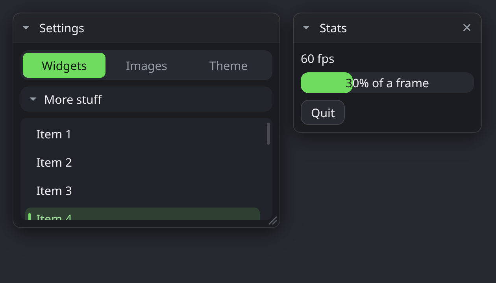

# Windows and layout

## Windows

```c
double x = 16, y = 16, w = 340, h = 0;
int open = 1;
if (goome_ui_window(u, "Settings", &x, &y, &w, &h, GOOME_WIN_MOVE | GOOME_WIN_RESIZE | GOOME_WIN_CLOSE, &open)) {
    goome_ui_label(u, "inside");
}
goome_ui_window_end(u);
```

```csharp
bool open = true;
if (ui.Window("Settings", ref x, ref y, ref w, ref h, WindowFlags.Move | WindowFlags.Resize | WindowFlags.Close, ref open))
    ui.Label("inside");
ui.WindowEnd();
```

```python
win = goome.Window(16, 16, 340)
with ui.window("Settings", win, goome.WIN_MOVE | goome.WIN_RESIZE | goome.WIN_CLOSE) as shown:
    if shown:
        ui.label("inside")
```

```java
Window win = new Window(16, 16, 340, 0);
if (ui.window("Settings", win, Ui.WIN_MOVE | Ui.WIN_RESIZE | Ui.WIN_CLOSE)) ui.label("inside");
ui.windowEnd();
```

Always call `goome_ui_window_end`, even when `goome_ui_window` returned 0 (collapsed or closed).

| Flag | What |
|:--|:--|
| `GOOME_WIN_MOVE` | drag it by the title bar |
| `GOOME_WIN_RESIZE` | a resize grip in the bottom right corner |
| `GOOME_WIN_COLLAPSE` | the little arrow that folds it to just the title |
| `GOOME_WIN_CLOSE` | an x that sets `*open` to 0 |
| `GOOME_WIN_NO_TITLE` | no title bar at all |

`h = 0` means fit the content. Windows stack in the order you click them, the last one clicked is on top.

## Rows and lines

Widgets stack one under the other. Most fill the width, buttons are as wide as their label.

- `goome_ui_row(u, 3)` puts the next 3 widgets side by side, sharing the width
- `goome_ui_same_line(u)` puts the next widget right of the last one
- `goome_ui_width(u, 120)` makes the next widget 120 wide (0 = fill)
- `goome_ui_space(u, 12)` adds a gap
- `goome_ui_separator(u)` draws a line

## Tabs and collapsing sections

```c
static const char *const tabs[] = {"Widgets", "Images", "Theme"};
int tab = 0, more = 1;
goome_ui_tabs(u, "tabs", tabs, 3, &tab);
if (goome_ui_collapsing(u, "More stuff", &more)) {
    goome_ui_label(u, "only shows while open");
}
```



## Scroll areas

```c
goome_ui_scroll_begin(u, "list", 130);
for (int i = 0; i < 100; i++) goome_ui_label(u, "row %d", i);
goome_ui_scroll_end(u);
```

Height 0 fills the rest of the window. Always call `goome_ui_scroll_end`. They nest, the wheel scrolls the innermost one under the mouse.
