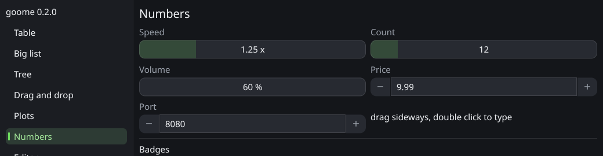
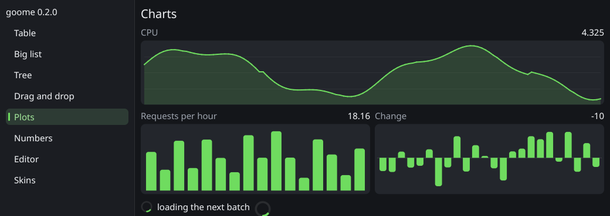
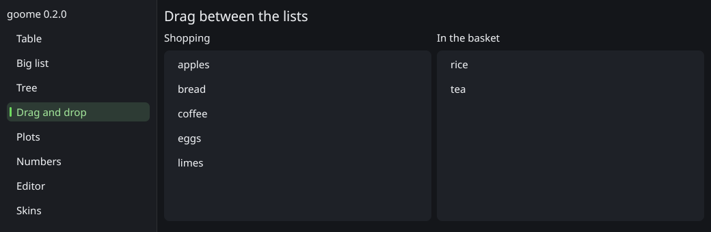
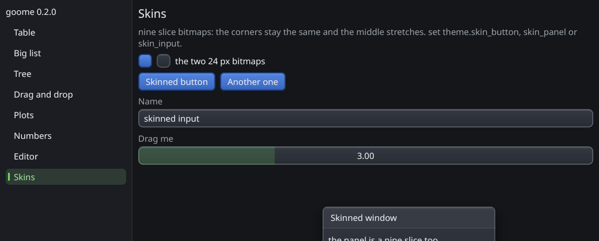

# Plots, drag and more <kbd>0.2</kbd>

## Drag values and number boxes

```c
goome_ui_drag_float(u, "Speed", &speed, 0.05, 0, 10, "%.2f");
goome_ui_drag_int(u, "Count", &count, 0.2, 0, 1000);
goome_ui_number(u, "Width", &width, 1, "%.0f px");
```

Drag values are a box with the number in it, drag sideways. `speed` is how fast it changes. `goome_ui_number` has - and + buttons that move by `step` and you can click in and type. They return 1 when the value changed.



## Plots

```c
float fps[120];
goome_ui_plot_lines(u, "fps", fps, 120, 0, 144, 60);
goome_ui_plot_bars(u, "frame ms", ms, 60, 0, 33, 60);
```

`min` and `max` are the range, `h` the height.



## Split panes

```c
static double frac = 0.3;
if (goome_ui_split_begin(u, "main", 0, &frac)) {
    draw_file_list();
    goome_ui_split_next(u);
    draw_editor();
}
goome_ui_split_end(u);
```

Two panes with a bar you can drag. `vertical` 0 is side by side, 1 is top and bottom. `frac` is the first pane's share, its your variable so save it with your layout.

## Drag and drop inside the UI

```c
for (int i = 0; i < n; i++) {
    goome_ui_selectable(u, names[i], 0);
    goome_ui_drag_source(u, "item", &i, sizeof(i));
}
goome_ui_label(u, "drop here to delete");
int got;
if (goome_ui_drop_target(u, "item", &got, sizeof(got))) remove_item(got);
```

`goome_ui_drag_source` makes the widget before it draggable with your data. `goome_ui_drop_target` makes the widget before it take drops of that type and returns how many bytes it copied into your buffer (0 if nothing dropped this frame).

Files from outside the app are `GOOME_DROP` events, see [Window mode](window-mode.md).



## Small stuff

| Widget | What |
|:--|:--|
| `goome_ui_spinner(u, size)` | a spinning loading circle, size 0 matches the text height |
| `goome_ui_link(u, text)` | text that looks like a link, hand cursor, returns 1 when clicked |
| `goome_ui_badge(u, text, argb)` | a small colored pill, like "new" or "3" |

## Nine-slice skins

Set a `goome_skin` on the theme to draw buttons, panels and inputs from a bitmap. A skin is the bitmap plus its border sizes in bitmap px, corners stay and the edges and middle stretch.

```c
goome_bitmap btn, panel;
goome_bitmap_load("button.png", &btn);
goome_bitmap_load("panel.png", &panel);
goome_theme *t = goome_ui_theme(u);
t->skin_button = (goome_skin){&btn, 8, 8, 8, 8};
t->skin_panel = (goome_skin){&panel, 8, 8, 8, 8};
t->skin_input = (goome_skin){&panel, 8, 8, 8, 8};
```

No bitmap = the normal look. The bitmaps are still yours, keep them loaded while the theme uses them. To draw a nine-slice yourself theres `goome_draw_bitmap_nine` in [Images and fonts](images-fonts.md).


