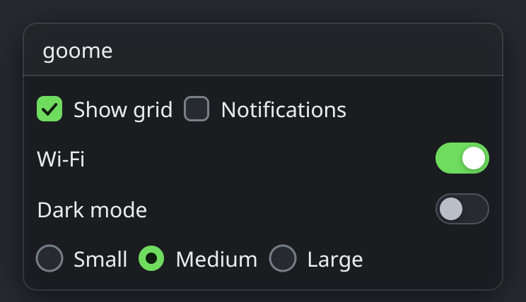
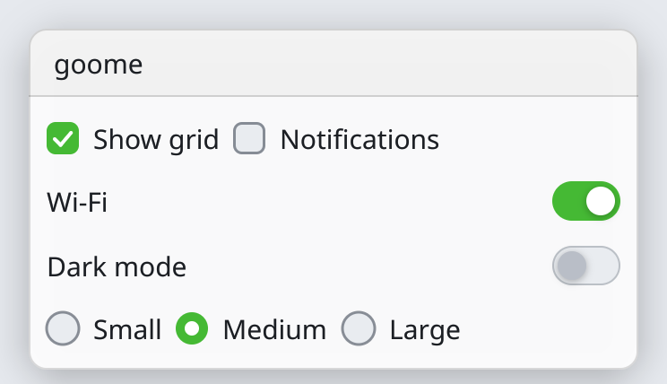

# Checkboxes and toggles



```c
int grid = 1, notify = 0, wifi = 1, size = 1;
goome_ui_checkbox(u, "Show grid", &grid);
goome_ui_same_line(u);
goome_ui_checkbox(u, "Notifications", &notify);
goome_ui_toggle(u, "Wi-Fi", &wifi);
goome_ui_radio(u, "Small", &size, 0);
goome_ui_same_line(u);
goome_ui_radio(u, "Medium", &size, 1);
goome_ui_same_line(u);
goome_ui_radio(u, "Large", &size, 2);
```

```csharp
bool grid = true, notify = false, wifi = true;
int size = 1;
ui.Checkbox("Show grid", ref grid);
ui.SameLine();
ui.Checkbox("Notifications", ref notify);
ui.Toggle("Wi-Fi", ref wifi);
ui.Radio("Small", ref size, 0);
ui.SameLine();
ui.Radio("Medium", ref size, 1);
ui.SameLine();
ui.Radio("Large", ref size, 2);
```

```python
grid = ui.checkbox("Show grid", grid)
ui.same_line()
notify = ui.checkbox("Notifications", notify)
wifi = ui.toggle("Wi-Fi", wifi)
size = ui.radio("Small", size, 0)
ui.same_line()
size = ui.radio("Medium", size, 1)
ui.same_line()
size = ui.radio("Large", size, 2)
```

```java
boolean grid = true, notify = false, wifi = true;
int size = 1;
grid = ui.checkbox("Show grid", grid);
ui.sameLine();
notify = ui.checkbox("Notifications", notify);
wifi = ui.toggle("Wi-Fi", wifi);
size = ui.radio("Small", size, 0);
ui.sameLine();
size = ui.radio("Medium", size, 1);
ui.sameLine();
size = ui.radio("Large", size, 2);
```

Checkboxes and toggles flip an int between 0 and 1 and return 1 the frame it changed. A toggle is a checkbox that looks like a switch.

Radios share one int. Each sets it to its own `value` when clicked and shows picked while the int equals it.

Light theme:


