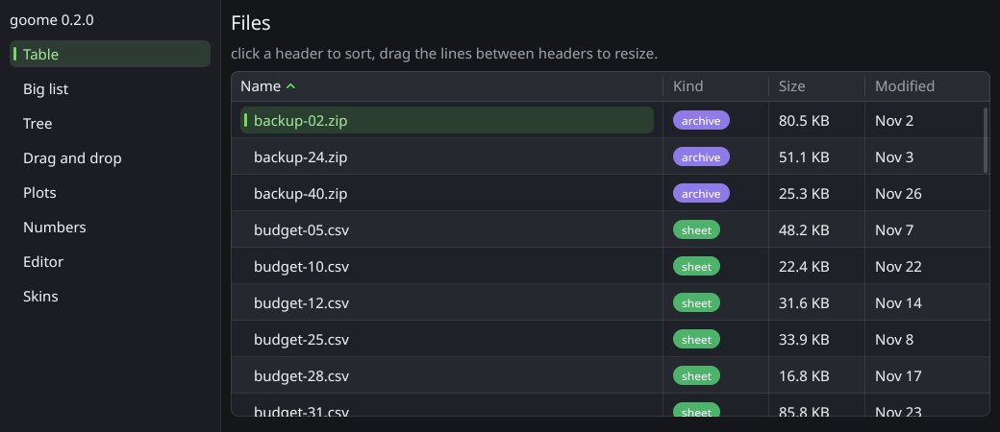
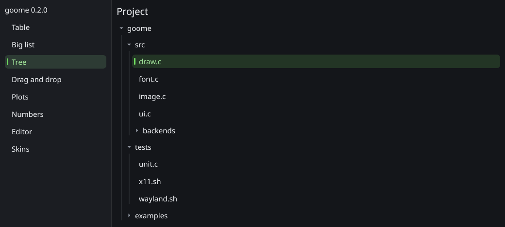
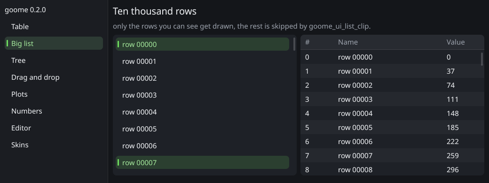
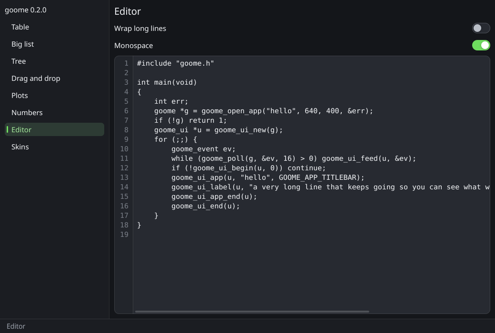

# Tables, trees and editors <kbd>0.2</kbd>



## Tables

```c
static int col = 0, desc = 0;
if (goome_ui_table_begin(u, "files", 3, 300, GOOME_TABLE_SORTABLE | GOOME_TABLE_RESIZABLE | GOOME_TABLE_STRIPES)) {
    goome_ui_table_column(u, "Name", 0);
    goome_ui_table_column(u, "Size", 80);
    goome_ui_table_column(u, "Kind", 100);
    if (goome_ui_table_sort(u, &col, &desc)) sort_files(col, desc);
    for (int i = 0; i < nfiles; i++) {
        goome_ui_table_row(u);
        goome_ui_label(u, "%s", files[i].name);
        goome_ui_table_next(u);
        goome_ui_label(u, "%d KB", files[i].kb);
        goome_ui_table_next(u);
        goome_ui_label(u, "%s", files[i].kind);
    }
}
goome_ui_table_end(u);
```

- `goome_ui_table_begin(u, id, cols, h, flags)` starts one, `h` is its height (it scrolls inside).
- `goome_ui_table_column(u, name, width)` once per column, width 0 shares what is left.
- `goome_ui_table_sort(u, &col, &desc)` returns 1 on the frame the user clicked a header. goome doesnt sort your data, you do.
- `goome_ui_table_row` starts a row and you are in its first cell, `goome_ui_table_next` moves to the next one (right after `table_row` it stays in cell 0). Any widget goes in a cell.

| Flag | What |
|:--|:--|
| `GOOME_TABLE_SORTABLE` | click a header to sort by it, again to flip |
| `GOOME_TABLE_RESIZABLE` | drag between headers to resize columns |
| `GOOME_TABLE_STRIPES` | every other row a bit darker |
| `GOOME_TABLE_BORDERS` | lines between cells |

## Trees

```c
static int open_src = 1;
if (goome_ui_tree(u, "src", &open_src)) {
    goome_ui_selectable(u, "goome.c", 0);
    goome_ui_selectable(u, "ui.c", 0);
    goome_ui_tree_end(u);
}
```

`goome_ui_tree` returns 1 while its open. Only call `goome_ui_tree_end` then. They nest.



## Big lists

```c
goome_ui_scroll_begin(u, "log", 0);
int first, last;
goome_ui_list_clip(u, nlines, 0, &first, &last);
for (int i = first; i < last; i++) goome_ui_selectable(u, lines[i], 0);
goome_ui_scroll_end(u);
```

In a scroll area or a table, `goome_ui_list_clip` gives you the visible rows (each `row_h` tall) and you only draw those. `last` is exclusive. `row_h` 0 = selectable height, or table row height inside a table. 10k rows cost the same as 30.



## Multiline text

```c
static char text[65536] = "";
goome_ui_text_edit(u, "code", text, sizeof(text), 400, GOOME_EDIT_LINE_NUMBERS | GOOME_EDIT_MONO);
```

Text editor with selection, clipboard, undo/redo, scrolling and page up/down. `h` is the height, 0 fills whats left. Returns 1 when the text changed.

| Flag | What |
|:--|:--|
| `GOOME_EDIT_READONLY` | you can select and copy, not type |
| `GOOME_EDIT_LINE_NUMBERS` | a gutter with line numbers |
| `GOOME_EDIT_WRAP` | wrap long lines instead of scrolling sideways |
| `GOOME_EDIT_MONO` | monospace, for code and logs |


