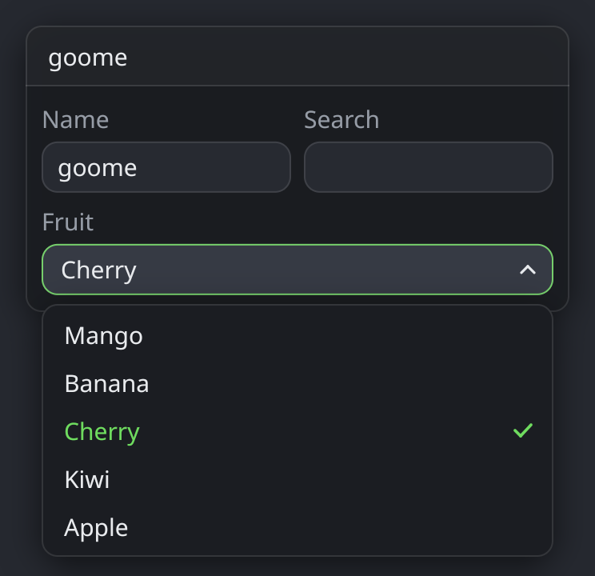

# Inputs, combos and lists



## Text input

```c
char name[64] = "goome";
if (goome_ui_input(u, "Name", name, sizeof(name))) printf("now %s\n", name);
```

```csharp
string name = "goome";
if (ui.Input("Name", ref name)) Console.WriteLine($"now {name}");
```

```python
name = ui.input("Name", name)
```

```java
String name = "goome";
name = ui.input("Name", name, 64);
if (ui.changed()) System.out.println("now " + name);
```

One line of utf-8 into your buffer, max `cap - 1` bytes. Returns 1 when the text changed. In overlay mode clicking in turns the keyboard on, enter, esc or clicking away gives it back.

<kbd>0.2</kbd> selection with the mouse and shift+arrows, double click for a word, ctrl+a, copy / cut / paste, one step of ctrl+z, home / end.

Multiline is `goome_ui_text_edit` (0.2), on [Tables, trees and editors](ui-tables.md).

### Passwords and hints <kbd>0.3</kbd>

```c
char pass[64] = "";
if (goome_ui_input_ex(u, "Password", pass, sizeof(pass), GOOME_INPUT_PASSWORD | GOOME_INPUT_ENTER_RETURNS, "8 letters or more") == 2) login(pass);
```

```csharp
string pass = "";
if (ui.InputEx("Password", ref pass, InputFlags.Password | InputFlags.EnterReturns, "8 letters or more") == 2) Login(pass);
```

```python
pw = ui.input_ex("Password", pw, goome.INPUT_PASSWORD | goome.INPUT_ENTER_RETURNS, "8 letters or more")
if ui.entered:
    login(pw)
```

```java
pass = ui.inputEx("Password", pass, 64, Ui.INPUT_PASSWORD | Ui.INPUT_ENTER_RETURNS, "8 letters or more");
if (ui.entered()) login(pass);
```

`goome_ui_input_ex(u, label, buf, cap, flags, hint)` is the input with extras. `hint` is the grey text you see while its empty, NULL = none. `goome_ui_input` is the same thing with no flags and no hint. Python sets `ui.entered` on enter and has `ui.password(label, text, hint)` as a short way. Java has `ui.entered()` and `ui.password(label, text, cap)`.

| Flag | What |
|:--|:--|
| `GOOME_INPUT_PASSWORD` | draws `cfg->mask` per letter ("*" by default), copy and cut do nothing |
| `GOOME_INPUT_READONLY` | no typing or pasting, you can still select and copy |
| `GOOME_INPUT_NUMBER` | only takes digits, + - and . |
| `GOOME_INPUT_NO_SELECT_ON_FOCUS` | tabbing in puts the caret at the end instead of selecting it all |
| `GOOME_INPUT_ENTER_RETURNS` | returns 2 on enter, handy for login and search boxes |

A password never gets drawn or measured as the real text. The caret and the selection go by the mask. Word jumps and double clicks treat the whole thing as one word so they dont show where the spaces are. The mask goes in the [config](ui-anything.md#the-config), `cfg->mask = "•"` works too.

## Combo box

```c
static const char *const fruits[] = {"Mango", "Banana", "Cherry", "Kiwi", "Apple"};
int fruit = 2;
goome_ui_combo(u, "Fruit", &fruit, fruits, 5);
```

```csharp
string[] fruits = { "Mango", "Banana", "Cherry", "Kiwi", "Apple" };
ui.Combo("Fruit", ref fruit, fruits);
```

```python
fruit = ui.combo("Fruit", fruit, ["Mango", "Banana", "Cherry", "Kiwi", "Apple"])
```

```java
fruit = ui.combo("Fruit", fruit, "Mango", "Banana", "Cherry", "Kiwi", "Apple");
```

The list opens over everything else and scrolls if its long.

## Selectable lists

```c
goome_ui_scroll_begin(u, "list", 150);
for (int i = 0; i < 30; i++) {
    char item[32];
    snprintf(item, sizeof(item), "Item %d", i + 1);
    if (goome_ui_selectable(u, item, picked == i)) picked = i;
}
goome_ui_scroll_end(u);
```

`goome_ui_selectable(u, label, selected)` is a full width row, returns 1 when clicked. In a scroll area thats a list box. For thousands of rows use `goome_ui_list_clip` (0.2) to only draw the visible ones.
