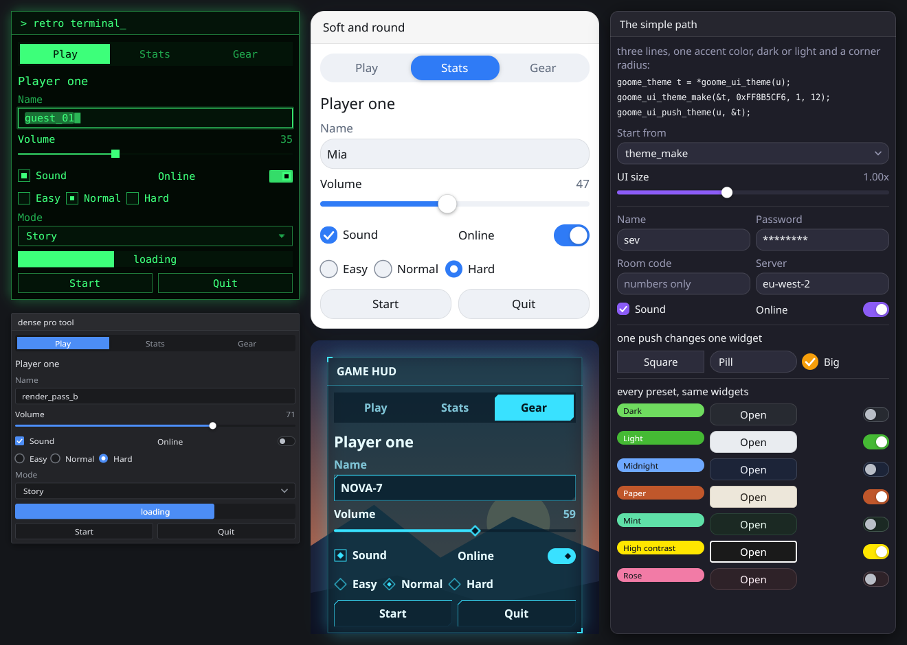

# Themes the simple way <kbd>0.3</kbd>

You dont have to fill in the whole theme to get your own look. Give it one accent color, dark or light and a corner radius, or pick a preset.

```c
goome_theme *t = goome_ui_theme(u);
goome_ui_theme_make(t, 0xFF8B5CF6, 1, 12);
goome_ui_scale(u, 1.25);
```

```csharp
var t = ui.Theme;
t.Make(0xFF8B5CF6, dark: true, radius: 12);
ui.Scale(1.25);
```

```python
t = ui.theme
t.make(0xFF8B5CF6, dark=True, radius=12)
ui.scale(1.25)
```

```java
ui.theme().set(Theme.make(ui.theme(), 0xFF8B5CF6, true, 12));
ui.scale(1.25);
```

Thats a purple dark theme at 125%. Do it once after `goome_ui_new`, not every frame.

In Java `Theme.make` and `Theme.preset` give you a new theme built on the one you pass, `ui.theme().set(t)` copies it into the ui.

## One color

`goome_ui_theme_make(t, accent, dark, radius)` starts from the dark or light theme and tints the greys a tiny bit towards the accent. Accent text ends up dark on a bright accent and white on a dark one. The checkbox and tooltip corners follow the radius you gave it, so 10 is exactly the old look. A radius below 0 means 10.

It leaves the font and your pictures alone.

Make it on a copy and push that if only part of the ui should change:

```c
goome_theme t = *goome_ui_theme(u);
goome_ui_theme_make(&t, 0xFF8B5CF6, 1, 12);
goome_ui_push_theme(u, &t);
goome_ui_button(u, "Purple");
goome_ui_pop(u, 1);
```

```csharp
var t = new Theme(ui.Theme);
t.Make(0xFF8B5CF6, dark: true, radius: 12);
using (ui.Style(theme: t))
    ui.Button("Purple");
```

```python
t = ui.theme.copy()
t.make(0xFF8B5CF6, dark=True, radius=12)
with ui.style(theme=t):
    ui.button("Purple")
```

```java
Theme t = Theme.make(ui.theme(), 0xFF8B5CF6, true, 12);
try (var s = ui.style().theme(t).push()) {
    ui.button("Purple");
}
```

## Presets

```c
goome_ui_theme_preset(goome_ui_theme(u), GOOME_PRESET_MIDNIGHT);
```

```csharp
ui.Theme.Preset(Preset.Midnight);
```

```python
ui.theme.preset(goome.PRESET_MIDNIGHT)
```

```java
ui.theme().set(Theme.preset(ui.theme(), Theme.PRESET_MIDNIGHT));
```

| Preset | Looks like |
|:--|:--|
| `GOOME_PRESET_DARK` | the default |
| `GOOME_PRESET_LIGHT` | same as `goome_ui_theme_light` |
| `GOOME_PRESET_MIDNIGHT` | dark blue, radius 8 |
| `GOOME_PRESET_PAPER` | warm light paper with an orange accent, radius 6 |
| `GOOME_PRESET_MINT` | dark green with a mint accent, radius 12 |
| `GOOME_PRESET_HIGH_CONTRAST` | pure black and white, yellow accent, 2px borders, no shadow |
| `GOOME_PRESET_ROSE` | dark with a pink accent, radius 14 |

They're the same ones the ui builder has, so a project from the builder looks the same in code. It returns `GOOME_EARG` for a number outside `GOOME_PRESET_COUNT` and leaves the theme alone then.

## Bigger or smaller

```c
goome_ui_scale(u, 1.25);
```

```csharp
ui.Scale(1.25);
```

```python
ui.scale(1.25)
```

```java
ui.scale(1.25);
```

`goome_ui_scale(u, s)` multiplies every size in the ui's theme at once. Thats the old sizes plus all the [new ones](ui-anything.md) that dont already grow with the font, so the ones that do dont end up scaled twice. Good for a "bigger ui" setting.

It multiplies whats there, so calling it every frame keeps growing. Set the theme first (`theme_make`, a preset or your own) and scale right after, like `examples/anything.c` does. 0, negative or over 64 does nothing.

This is not the hi dpi scale, goome already handles that by itself ([Coords and monitors](coords.md)).



`examples/anything.c` in c-goome. The bottom right card goes through `theme_make` and every preset.
