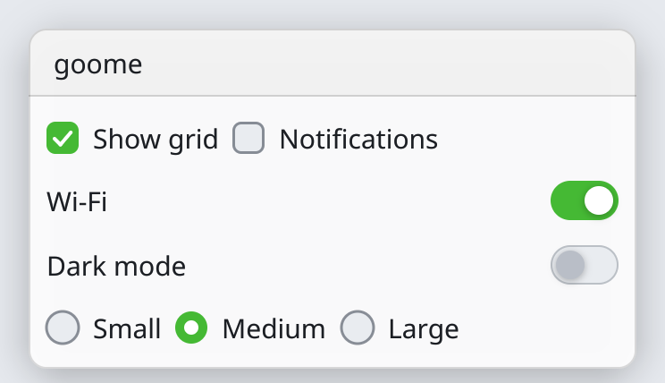

# Themes

`goome_ui_theme(u)` hands you the `goome_theme` the UI draws with. Change any field and the next frame uses it.

```c
goome_theme *t = goome_ui_theme(u);
t->accent = 0xFF4FA3FF;
t->radius = 6;
t->font_size = 15;
```

```csharp
ui.Theme.Accent = 0xFF4FA3FF;
ui.Theme.Radius = 6;
ui.Theme.FontSize = 15;
```

```python
ui.theme.accent = 0xFF4FA3FF
ui.theme.radius = 6
ui.theme.font_size = 15
```

```java
ui.theme().accent(0xFF4FA3FF).radius(6).fontSize(15);
```

## Dark and light

`goome_ui_theme_dark(t)` and `goome_ui_theme_light(t)` reset every color and size to the built in ones. They leave the font alone. Dark is the default.



## The fields

| Field | What |
|:--|:--|
| `bg` | behind everything, app mode fills with it |
| `panel` | window background |
| `border` | window and widget outlines |
| `text`, `text_dim` | normal and quieter text |
| `accent`, `accent_text` | checked boxes, slider fill, the active tab, and text on top of it |
| `hover`, `active` | widget backgrounds while hovered and pressed |
| `input_bg` | inside inputs, sliders and combos |
| `shadow` | window shadow color |
| `radius` | corner radius |
| `pad`, `gap` | space inside windows and between widgets |
| `border_width` | outline width |
| `font_size` | text size, checkboxes and knobs grow with it |
| `shadow_blur` | how soft window shadows are |
| `anim_ms` | how long hovers and toggles take, 0 turns animation off |
| `font` | a `goome_font`, NULL = built in |
| `skin_button`, `skin_panel`, `skin_input` <kbd>0.2</kbd> | optional nine-slice bitmaps, see [skins](ui-more.md#nine-slice-skins) |
| `icon`, `icon_tint`, the other `skin_*` <kbd>0.3</kbd> | your own pictures, see [Icons and skins](ui-icons.md) |

`goome_ui_new` puts the system font in `font` and frees it in `goome_ui_free`. Your own font you free yourself, after `goome_ui_free`.

0.2 has a lot more fields after these, every number and color the kit uses. Theyre on [Change anything](ui-anything.md). For a quick look without touching fields theres [Themes the simple way](ui-theme-easy.md).

Colors are `0xAARRGGBB`. Panel alpha below `FF` lets the desktop show through in overlay mode. 0.2 only added fields at the end, old code still works.
