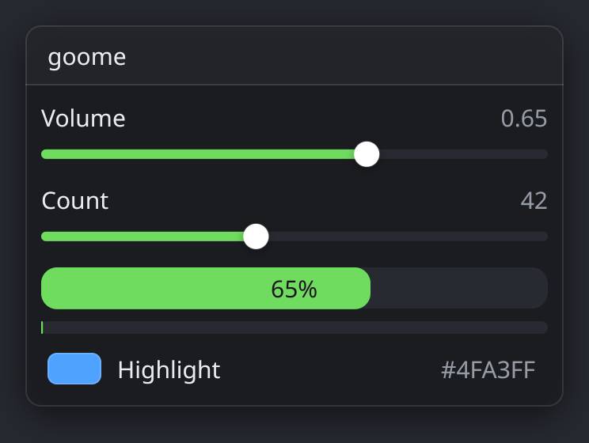

# Sliders and colors

```c
double volume = 0.65;
int count = 42;
uint32_t color = 0xFF4FA3FF;
goome_ui_slider(u, "Volume", &volume, 0, 1, "%.2f");
goome_ui_slider_int(u, "Count", &count, 0, 100);
goome_ui_progress(u, 0.65, "65%");
goome_ui_progress(u, -1, NULL);
goome_ui_color(u, "Highlight", &color);
```

```csharp
ui.Slider("Volume", ref volume, 0, 1, "%.2f");
ui.SliderInt("Count", ref count, 0, 100);
ui.Progress(0.65, "65%");
ui.Progress(-1);
ui.Color("Highlight", ref color);
```

```python
volume = ui.slider("Volume", volume, 0, 1, "%.2f")
count = ui.slider_int("Count", count, 0, 100)
ui.progress(0.65, "65%")
ui.progress(-1)
color = ui.color("Highlight", color)
```

```java
volume = ui.slider("Volume", volume, 0, 1, "%.2f");
count = ui.sliderInt("Count", count, 0, 100);
ui.progress(0.65, "65%");
ui.progress(-1);
color = ui.color("Highlight", color);
```

```rust
ui.slider_fmt("Volume", &mut volume, 0.0, 1.0, Some("%.2f"));
ui.slider_int("Count", &mut count, 0, 100);
ui.progress(0.65, Some("65%"));
ui.progress(-1.0, None);
ui.color("Highlight", &mut color);
```

```go
ui.SliderFmt("Volume", &volume, 0, 1, "%.2f")
ui.SliderInt("Count", &count, 0, 100)
ui.Progress(0.65, "65%")
ui.Progress(-1, "")
ui.Color("Highlight", &color)
```

```zig
_ = ui.slider("Volume", &volume, 0, 1, "%.2f");
_ = ui.sliderInt("Count", &count, 0, 100);
ui.progress(0.65, "65%");
ui.progress(-1, null);
_ = ui.color("Highlight", &color);
```

```lua
volume = ui:slider("Volume", volume, 0, 1, "%.2f")
count = ui:slider_int("Count", count, 0, 100)
ui:progress(0.65, "65%")
ui:progress(-1)
color = ui:color("Highlight", color)
```

```js
volume = ui.slider("Volume", volume, 0, 1, "%.2f");
count = ui.sliderInt("Count", count, 0, 100);
ui.progress(0.65, "65%");
ui.progress(-1);
color = ui.color("Highlight", color);
```



The slider format is printf style, only for the number on the right. NULL shows it plain.

`goome_ui_progress` takes 0 to 1, below 0 is a busy bar that slides back and forth.

`goome_ui_color` is a swatch and the hex. Click it for a picker with saturation / value, hue and alpha. Returns 1 while it changes the color.
