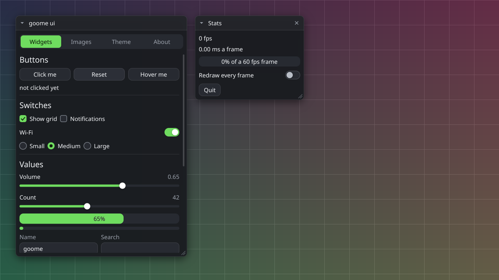

# How the ui kit works

Immediate mode, like Dear ImGui but made for overlays first. You keep your own variables and call the widgets every frame.



## The loop

```c
goome_ui *u = goome_ui_new(g);
double x = 40, y = 40, w = 300, h = 0, volume = 0.5;
int muted = 0, running = 1;

while (running) {
    goome_event ev;
    while (goome_poll(g, &ev, 16) > 0) {
        if (ev.type == GOOME_QUIT) running = 0;
        goome_ui_feed(u, &ev);
    }
    if (!goome_ui_begin(u, 0)) continue;
    if (goome_ui_window(u, "Settings", &x, &y, &w, &h, GOOME_WIN_MOVE | GOOME_WIN_COLLAPSE, NULL)) {
        if (goome_ui_button(u, "Say hi")) puts("hi");
        goome_ui_slider(u, "Volume", &volume, 0, 1, "%.2f");
        goome_ui_toggle(u, "Muted", &muted);
    }
    goome_ui_window_end(u);
    goome_ui_end(u);
}
goome_ui_free(u);
```

```csharp
using var ui = new Ui(g);
double x = 40, y = 40, w = 300, h = 0, volume = 0.5;
bool muted = false;

for (bool running = true; running;)
{
    while (g.Poll(out var ev, 16))
    {
        if (ev.Type == EventType.Quit) running = false;
        ui.Feed(ev);
    }
    if (ui.Begin(0) == null) continue;
    if (ui.Window("Settings", ref x, ref y, ref w, ref h, WindowFlags.Move | WindowFlags.Collapse))
    {
        if (ui.Button("Say hi")) Console.WriteLine("hi");
        ui.Slider("Volume", ref volume, 0, 1, "%.2f");
        ui.Toggle("Muted", ref muted);
    }
    ui.WindowEnd();
    ui.End();
}
```

```python
with g.ui() as ui:
    win = goome.Window(40, 40, 300)
    volume, muted, running = 0.5, False, True
    while running:
        for ev in g.events(16):
            if ev.type == goome.QUIT:
                running = False
            ui.feed(ev)
        with ui.frame(0) as c:
            if c is None:
                continue
            with ui.window("Settings", win, goome.WIN_MOVE | goome.WIN_COLLAPSE) as shown:
                if shown:
                    if ui.button("Say hi"):
                        print("hi")
                    volume = ui.slider("Volume", volume, 0, 1, "%.2f")
                    muted = ui.toggle("Muted", muted)
```

```java
try (Ui ui = g.ui()) {
    Window win = new Window(40, 40, 300, 0);
    double volume = 0.5;
    boolean muted = false, running = true;
    while (running) {
        for (Event e : g.events(16)) {
            if (e.type() == Goome.QUIT) running = false;
            ui.feed(e);
        }
        if (ui.begin(0) == null) continue;
        if (ui.window("Settings", win, Ui.WIN_MOVE | Ui.WIN_COLLAPSE)) {
            if (ui.button("Say hi")) System.out.println("hi");
            volume = ui.slider("Volume", volume, 0, 1, "%.2f");
            muted = ui.toggle("Muted", muted);
        }
        ui.windowEnd();
        ui.end();
    }
}
```

```rust
let mut ui = goome::Options::new().title("settings").open()?.ui()?;
let mut win = goome::WindowState::new(40.0, 40.0, 300.0, 0.0);
let (mut volume, mut muted, mut running) = (0.5, false, true);
while running {
    for ev in ui.pump(16) {
        if ev.kind == goome::QUIT {
            running = false;
        }
    }
    let Some(mut f) = ui.begin(0) else { continue };
    let mut w = f.window("Settings", &mut win, goome::WIN_MOVE | goome::WIN_COLLAPSE);
    if w.shown() {
        if w.button("Say hi") {
            println!("hi");
        }
        w.slider("Volume", &mut volume, 0.0, 1.0);
        w.toggle("Muted", &mut muted);
    }
}
```

```go
ui, _ := g.NewUI()
defer ui.Free()
win := goome.NewWindow(40, 40, 300, 0)
volume, muted := 0.5, false
for running := true; running; {
	for ev := range g.Events(16) {
		if ev.Type == goome.EventQuit {
			running = false
		}
		ui.Feed(ev)
	}
	if ui.Begin(0) != nil {
		if ui.Window("Settings", win, goome.WinMove|goome.WinCollapse) {
			if ui.Button("Say hi") {
				fmt.Println("hi")
			}
			ui.SliderFmt("Volume", &volume, 0, 1, "%.2f")
			ui.Toggle("Muted", &muted)
		}
		ui.End()
	}
	ui.End()
}
```

```zig
const ui = try g.ui();
defer ui.deinit();
var win: goome.Window = .{ .x = 40, .y = 40, .w = 300 };
var volume: f64 = 0.5;
var muted = false;
while (true) {
    while (try g.poll(16)) |ev| {
        if (ev.kind == .quit) return;
        _ = ui.feed(ev);
    }
    _ = ui.begin(0) orelse continue;
    if (ui.window("Settings", &win, goome.win.move | goome.win.collapse)) {
        if (ui.button("Say hi")) std.debug.print("hi\n", .{});
        _ = ui.slider("Volume", &volume, 0, 1, "%.2f");
        _ = ui.toggle("Muted", &muted);
    }
    ui.windowEnd();
    ui.end();
}
```

```lua
local ui = g:ui()
local win = {x = 40, y = 40, w = 300, h = 0}
local volume, muted, running = 0.5, false, true
while running do
  for ev in g:events(16) do
    if ev.type == goome.QUIT then running = false end
    ui:feed(ev)
  end
  if ui:begin(0) then
    if ui:window("Settings", win, goome.WIN_MOVE + goome.WIN_COLLAPSE) then
      if ui:button("Say hi") then print("hi") end
      volume = ui:slider("Volume", volume, 0, 1, "%.2f")
      muted = ui:toggle("Muted", muted)
    end
    ui:window_end()
    ui:finish()
  end
end
```

```js
const ui = g.ui();
const win = { x: 40, y: 40, w: 300 };
let volume = 0.5, muted = false, running = true;
while (running) {
  for (const ev of g.events(16)) {
    if (ev.type === goome.QUIT) running = false;
    ui.feed(ev);
  }
  ui.frame(0, () => {
    ui.window("Settings", win, goome.WIN_MOVE | goome.WIN_COLLAPSE, () => {
      if (ui.button("Say hi")) console.log("hi");
      volume = ui.slider("Volume", volume, 0, 1, "%.2f");
      muted = ui.toggle("Muted", muted);
    });
  });
}
```

Every frame:

1. feed it every event with `goome_ui_feed`. It returns 1 when the UI used the event
2. `goome_ui_begin(u, mon)` starts the frame on a monitor. NULL means skip this frame
3. call your windows and widgets
4. `goome_ui_end(u)` draws it all and sends it, with every window as a hit rect

## Values

The slider doesnt own `volume`, you do. Change it anywhere and the slider shows it next frame. Same with window `x`, `y`, `w`, `h`, save them and pass them back next run to restore the layout.

Widgets that change something return 1 on the frame they changed it (C#, Rust, Go and Zig return `true`, Python and Node set `ui.changed`). Java, Python, Node and Lua widgets give back the new value instead, Java has `ui.changed()` and Lua gives back if it changed as a second value.

## Ids

Widgets keep a bit of state (hover animation, scroll offset, text cursor) by id, and the id is the label. Same label in the same window = shared state.

Anything after `##` is part of the id but not shown, so `"Save##top"` and `"Save##bottom"` are two buttons that both say Save. In a loop push something unique:

```c
for (int i = 0; i < n; i++) {
    char id[16];
    snprintf(id, sizeof(id), "%d", i);
    goome_ui_push_id(u, id);
    if (goome_ui_button(u, "Delete")) remove_item(i);
    goome_ui_pop_id(u);
}
```

## Drawing less

Only draw after an event or while `goome_ui_animating(u)` says somethings still moving (a hover fading in, a toggle sliding over, your own [animations](animations.md) <kbd>0.5</kbd>). See [Frames, damage and pacing](frames.md).

## Widgets

- [Windows and layout](ui-layout.md)
- [Text and buttons](ui-buttons.md)
- [Checkboxes and toggles](ui-switches.md)
- [Sliders and colors](ui-values.md)
- [Inputs, combos and lists](ui-text.md)
- [Themes](ui-theme.md)
- [Themes the simple way](ui-theme-easy.md) <kbd>0.3</kbd>
- [Icons and skins](ui-icons.md) <kbd>0.3</kbd>
- [App mode and menus](ui-app.md) <kbd>0.2</kbd>
- [Keyboard and focus](ui-keyboard.md) <kbd>0.2</kbd>
- [Tables, trees and editors](ui-tables.md) <kbd>0.2</kbd>
- [Plots, drag and more](ui-more.md) <kbd>0.2</kbd>
- [Custom everything](ui-custom.md) <kbd>0.3</kbd>
- [Change anything](ui-anything.md) <kbd>0.3</kbd>
- [Animations](animations.md) <kbd>0.5</kbd>
- [Screen readers](accessibility.md) <kbd>0.5</kbd>

`#define GOOME_NO_UI` before the implementation leaves the UI kit out.
